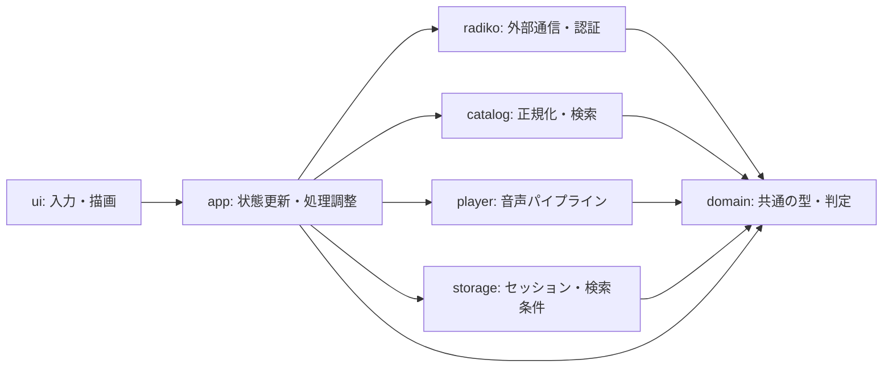
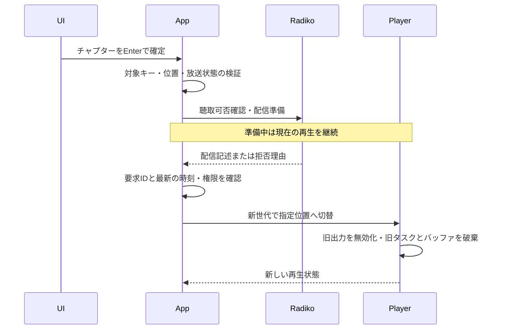

# アーキテクチャ設計

現行の実装・実機確認範囲は[現在の検証範囲](validation.md)を参照する。日付付きの節は導入経緯も含む。検証結果を全局・全形式の保証へ広げず、制約は同資料と[実装状況](implementation.md)で確認する。

## 再生中HTTPの段階別診断（2026年10月21日）

PreparedStreamを再生ワーカーへ渡す時点で、そのHLS用Httpだけに有限のRequestMeasurementsを作る。GETの応答待ち・本文受信・再試行待ち・待機を分け、現在段階の実時間、応答待ち／本文受信の最大時間、要求開始数と再試行待ち開始数を保持する。応答待ちはreqwestのsend全体であり、名前解決・接続・TLS・送信・応答ヘッダーのどれが遅いかまでは分離しない。試行数は送信完了やサーバー到達の証明ではない。再試行待ち数は取消で次を送らなかった場合も含む。各GETの終了・失敗・取消では待機へ戻す。

履歴、URL、ヘッダー、本文は保持しない。Mutexは段階更新・スナップショットのコピーだけに使い、I/O中には保持しない。音声コールバックでは参照しない。計測のロックに失敗しても再生を失敗させない。会員認証や番組表HTTPは計測対象へ追加せず、HTTPの時間・サイズ・取消・再試行条件は変更しない。

CLIと高さ36行以上のTUIに通信診断を表示し、小さい端末では操作一覧から現在または終了後の直近値を読む。終了後の値は最終集計と区別する。新しい再生ワーカーごとに計測を交換する。手動検証は既知の診断行から固定の段階名と数値だけを記録する。

## 容量2のPCM先読み（2026年10月21日）

取得段階9.5〜11秒の待ちと不足が観測されたため、デコード済みPCMの待機キューを1から2セグメントへ増やす。1セグメント4MiBの上限は維持し、キューは最大8MiBとする。キュー外には主制御の現在PCMとワーカーの配送待ちPCMが各1個存在し得る。機器のリングは2秒分、開始に必要な有効PCMも2秒分のままとし、先読みを満杯にするために再生開始を遅らせない。準備中の新旧二世代は各々独立した上限を持つ。

キュー満杯では次の取得へ進まず、取消時に配送待ちを終了して旧世代のキューを破棄する。404・429や配信窓消失の再解決、30秒のセグメント待ち期限、機器エラーの扱いは変えない。追加の先読みは一時的な取得遅延への余裕であり、通信待ちや音切れをすべて解消する保証とはしない。

## 再生中のHLS失敗段階（2026年10月21日）

連続再生中のHTTP失敗は、HLS音声取得とHLS一覧更新の固定段階名を付けて通知する。元のエラーを保持し、URL・応答本文・資格情報を追加しない。失敗時に取得済み通し番号を進めず、HLS層から再送や配信先の再解決を追加しない。共通GETの最大3回の一時障害再試行と、404・429・認証拒否・取消を再試行しない条件は維持する。手動検証は段階名をsegment／playlistの固定値に変換し、未知の文言をJSONへ転記しない。

## 音量変更の受理境界（2026年10月21日）

音量キーは変更要求だけを作り、再生サービスが受理した場合に画面の設定値を更新する。操作キュー満杯・切断・停止処理中の拒否では、画面と次回再生に引き継ぐ音量を変更しない。未再生時はサービスが0〜100へ正規化して受理し、再生中は同じ正規化値を容量4の操作キューへ渡す。実際に適用された再生中の音量はPlaybackSnapshotで表示する。受付成功はCPALでの適用完了を意味しない。

## スリープ復帰の明示検証（2026年10月21日）

手動再生検証の--sleep-checkは、ミュート出力を5秒確認してから操作者のawake入力を最大10分待つ。スリープは操作者だけが行い、復帰後の停止／出力継続を固定の診断分類で記録する。入力確認をOSスリープの自動検知とは扱わない。操作一覧の応答を確認し、明示的に停止・同枠を再生し直して、その新しい出力世代の秒数を本測定とする。スリープ前の秒数は加算しない。通常テストは偽画面と偽入力で停止・継続の両経路と機密文言を出力しないことを確認する。

## コールバック停止後の操作案内（2026年10月21日）

音声コールバックが3秒進まない場合は従来どおり出力を停止し、スリープ復帰・機器変更後は出力先を確認して番組を選び直すよう案内する。停止の原因がスリープだったと自動判定した表示にはせず、自動再生・出力先変更は行わない。明示的な再生では通常の権限確認と新しい出力機器の準備を行う。

## 再生制御セッションの開始通知（2026年10月21日）

終了した再生制御セッションの後に新しいセッションを開始する際は、Update.new_sessionを通知する。古い終了通知が未読でも画面は古い再生スナップショット・診断・通知を初期化し、同じUpdateに新しいスナップショットがあればその後に反映する。新セッション開始前に旧制御スレッドの終了を確認し、旧通知が後から混ざらない構成を維持する。稼働中の切替／シーク準備ではこの初期化を行わず、現在の再生と表示を継続する。

## 長い番組名でも再生対象を識別（2026年10月21日）

通常画面と操作一覧の再生欄は「再生中: [局ID / モード] 番組名」の順で表示し、長い番組名で局・モードが見切れないようにする。放送日時は通常画面の次行で示す。操作一覧では状態・音量も番組名より前に表示する。選択移動や閲覧だけで再生を変えない仕様は維持する。手動検証は明示された局・モードと次行の日時を照合し、番組名に含まれる局IDを再生対象の根拠にしない。

## GET本文の途中切断と再試行（2026年10月21日）

共通の読み取り専用GETは、ヘッダー待ちの通信断・HTTP 408／5xx・本文受信中の通信断を、同じ要求先ごとの最大3回の再試行予算で扱う。部分本文は破棄し、同じGETを最初から送る。本文の後半へ継ぎ足したり失敗データを成功として返さない。取消・認証拒否・404・429・サイズ超過・不正範囲などは再試行しない。リダイレクト上限・信頼先・サイズ制限・指数バックオフと取消確認を維持する。request_onceと認証POSTはこの再試行へ接続しない。

## 無音の出力単独診断（2026年10月21日）

probe-output --mute [SECONDS]は認証・通信・AAC復号を使わず、ゼロ値の1秒PCMを同じContinuousOutputへ繰り返し渡す明示実行用の診断とする。既定30秒・最大1800秒、出力リング2秒と1秒PCMの有界メモリを維持し、Ctrl+Cで終了する。アプリ音量も開始前から0とし、5秒ごとの出力フレーム・不足だけを通知する。既存のフラグなし生成音は1〜10秒のまま維持する。自動テストから実機出力を行わず、無音プローブの成功を配信・デコード・聴感の成功とはしない。

## 再生ワーカーの段階計測（2026年10月21日）

player::diagnostics::Trackerを各WorkerがArc<Mutex<_>>で所有する。poll_segmentとデコードの前後、容量2のPCM配送待ち、配信更新待ちを区別し、PlaybackSnapshot.pipelineへ短いロックでコピーする。通信・デコード・待機中にはロックを保持せず、音声コールバックから参照しない。Instantによる実時間の最大値と現在段階の経過時間を保持するだけで、履歴配列は作らない。Readyの切替でWorkerごと交換し、CLI statusとTUIの独立した診断行へ表示する。手動検証スクリプトは固定段階名と整数ミリ秒だけをJSONへ記録する。再生／カタログの子プロセスは独立セッションで起動して親の制御端末を継承せず、crosstermに指定したPTYのstdoutサイズを使わせる。描画した枠の右下角が指定寸法と一致することも確認する。

## チャプターの対応付け未確認の理由（2026年10月20日）

対応付け未確認を、イベント情報を確認できない・章と枠の開始位置が異なる・放送枠の照合が一致しない理由に分けてCLIとTUIへ渡す。理由は型付きの状態と固定の文言で表示し、URL・認証情報を含めない。異なる開始位置では章API取得や位置補正を行わず、ジャンプ不可を維持する。古い要求の結果は理由も含めて破棄する。

## 入力欄の修飾キー（2026年10月20日）

/で開くキーワード欄でもCtrl+Uで下書きを消去できる。Ctrl／Alt付きのCharイベントを通常の文字として追加せず、編集以外の再生・取得・認証操作にも転送しない。?やeを含む通常の文字は入力する。確定はEnter、取消はEsc、Ctrl+Cは従来どおり終了する。消去・入力・取消だけでは通信しない。秒数指定欄もCtrl／Alt付きの数字を追加しない。

## チャプター要約の閲覧（2026年10月20日）

章の閲覧中はTab／Shift+Tabで章一覧と要約欄を切り替える。要約欄に移ると領域を広げ、上下／j k・ページ・Home／Endを本文のスクロールとして扱う。章一覧へ戻ると選択移動として扱う。読むだけでは取得・再生操作を行わず、Enterは選択章からの再生確定を維持する。章の変更・開き直し・閉じる操作で本文の位置をリセットし、折り返しと端末サイズ変更に合わせて範囲を補正する。本文は従来の先頭1200文字までのプレビューであり、上限を画面に明示する。

## 操作一覧のスクロール（2026年10月20日）

操作一覧の上下／j k・PageUp／PageDown・Home／Endで折り返し後の行をスクロールする。末尾で止まり、端末サイズ変更時には範囲を補正する。検索・認証・再生へキーを転送せず、Esc・?・qで一覧だけを閉じ、Ctrl+Cで終了する。低い端末でもガイドの末尾を確認できるようにする。採用版Ratatui 0.29.0のunstable-rendered-line-infoを明示して有効化し、Paragraphの内側の幅でline_countを計算する。追加のラップ実装は持たず、描画と同じ折り返しを使用する。このAPIはバージョン更新時に再確認する。

## 取得状況・未取得範囲の閲覧（2026年10月20日）

通常画面と章の閲覧中のeで、今回の検索の地域失敗・局／放送日別失敗を読み取り専用画面で開く。件数と不正枠の除外件数を分け、正常枠と混在する不正枠除外の局・放送日も保持して表示する。正常に取得できた枠は番組一覧へ残す。上下・ページ・Home／Endですべての失敗を閲覧する。q・e・Escは元の画面へ戻り、Ctrl+Cは終了する。通信・認証・再生操作へキーを転送せず、検索と再生は継続する。検索確定で消去された古い失敗を保持しない。取得中の未取得範囲は完了まで確定しないことを示す。

## 番組一覧のページ移動（2026年10月20日）

番組一覧のPageUp／PageDownは直近の描画で確定した一覧内部の行数だけ選択を移動し、Home／Endは先頭／末尾へ移動する。端末の高さ変更を次の描画で反映し、表示行数が0でも1件移動できる。空一覧では未選択、端では停止する。ライブ一覧でも同じ表示対象の範囲で移動する。チャプター閲覧中は章一覧内で移動し、背後の番組選択を変更しない。選択だけでは取得・再生操作を発行せず、入力欄やモーダル固有のキー処理を優先する。

## 一覧の表示範囲だけの整形（2026年10月19日）

src/tui/viewport.rsは全体のListState・行数・表示可能高さから半開区間を求める。選択とoffsetは全体の添字として保持し、描画用にだけ相対選択を持つ一時ListStateと可視範囲のListItemを作る。行は折り返さない一行の番組項目に限定する。結果縮小時に選択を補正し、0件で解除する。高さ0でも範囲外参照をせず、選択を表示用の相対添字で上書きしない。検索・再生・チャプター状態は変更しない。

## 読み取り専用の操作一覧（2026年10月19日）

Screen.help_openだけで表示を切り替え、src/tui/help.rsはキー一覧と現在のPlaybackSnapshotを描画する。通信・保存・プレイヤー制御を呼ばず、メインループの状態通知は継続して反映する。キー処理はCtrl+Cの直後に開いている一覧を優先し、閉じるキー以外を消費する。通常画面でのみ?を開く操作へ解釈し、各エディターの文字入力を優先する。

## パケット境界でのデコード取消（2026年10月19日）

AdtsDecoder::decode_segment_pcm_controlledは所有ワーカーの世代取消を借用したFnMutで受ける。PCM確保前・ADTS走査・デコーダー初期化前・各パケットの前後・成功返却前を確認し、AacError::Cancelledで部分PCMとデコーダー状態を破棄する。既存の非制御APIは常にfalseのアダプターを使う。連続再生ワーカーは同じStopTokenを渡し、取消後の結果配送も従来どおり拒否する。別スレッドや共有ロックは追加せず、単一パケット実行中は既存デコーダーが戻るまで待つ。

## 配信確認の表示と手動検証境界（2026年10月19日）

domain::ListeningAvailabilityはUnknown／Unavailable(reason)／CurrentOutputを区別し、app::playback::availabilityが取得や永続保存なしで算出する。放送前とライブ終了を先に判定し、現在のPlaybackSnapshotの局ID・開始終了・モード・正の出力フレームが一致する場合だけCurrentOutputとする。契約フラグや放送終了を配信許可へ変換せず、再生要求では従来の認証・配信条件確認を必ず行う。

scripts/verify_tui_playback.pyは明示実行するmacOS向け手動検証である。0700の一時領域へ実行ファイルを独立コピーしSHA-256を報告、0600でセッションを一時複製する。番組一覧は毎回取得してメモリだけで選択し、PTYの有界な画面投影から数値診断を読み取る。UTF-8とCSIを分割受信できる増分処理を用い、端末内容をログへ出さない。検索0件時はcで画面が開いたことを確認してからEscを送る。SIGINT／SIGTERMでも子を終了して一時領域を削除する。

## 原点一致のEventBindingとジャンプ（2026年10月18日）

7日以内と8〜30日前のTBS各一章で音声との対応をユーザーが確認した。取得器は局・eventId・放送枠・episodeIntroductionStartAtを照合し、原点が枠開始と一致する場合だけEventBindingを生成しOutcome::Alignedへ付ける。異なる原点の補正は行わない。従来のCandidatesは閲覧専用のままとする。

app::chaptersはbindingの局ID・開始終了を対象と照合し、再取得・取消・失敗で破棄する。要求IDと対象キーで旧結果を拒否する。Enterは章の開始終了の範囲を検証し、同じ放送枠のタイムフリーならSeekSlot、別枠やライブなら開始位置付きSelectを送る。放送前の拒否、セッション確認・聴取可否判定・HLS時刻検証は既存経路を共用する。準備成功後に旧音声を破棄して切り替える。閲覧移動では再生を変更しない。

現在章は再生中と閲覧中の局ID・開始終了・タイムフリーモードが一致するときだけChapterSet.currentで求める。重複は後の開始位置、同時刻なら元配列の順序を優先し、隙間には表示しない。選択カーソルと再生位置の表示は独立する。この節は過去の閲覧専用段階の記述を更新する。

2026年10月15日策定。[機能設計](design.md)の仕様を実装へ落とすための構成・状態・処理境界を定義する。初期実装の進捗は[実装状況](implementation.md)に記録する。この設計書は実通信や再生の成立を示すものではない。

## 取消可能な共通HTTP（2026年10月18日）

reqwestのblocking機能を外し、共通Httpと会員認証を非同期Clientへ移行する。既存Fetch／MemberClientの同期インターフェースは維持し、取得ワーカー上で共有のcurrent-thread Tokio Runtimeを駆動する。要求ごとの通信スレッドは作らず、待機futureを10ms間隔で取消確認して破棄する。ヘッダー待ち・本文受信・再試行待ちで取消を処理し、部分本文は返さない。既存のサイズ上限・信頼先・HTTPS・リダイレクト制限と再試行上限を保つ。

DNSは共有の最大4 blockingスレッドと4許可のsemaphoreを使う。OS名前解決自体は中断できないため、取消後もその処理が終わるまで許可を保持する。許可待ちの取消は新たなDNS作業を開始しない。ドライバーは複数取得から同時利用でき、一件の取消を他の要求へ伝播しない。

TUI検索・チャプター取得・会員確認・再生準備・実行中HLS、および再生CLIの初回／対話準備は、各領域の要求世代から所有する取消通知を渡す。旧factoryのAPIはアダプターで互換性を保つ。古い結果の世代照合、検索最大4並列、各サービスの単一active／最新pendingは継続する。

認証用request_onceはリダイレクトと自動再試行を行わず、成功本文を最大64KiBに制限する。会員確認GETだけが従来どおり最大3回再試行し、Cancelledを通信断や失効として再試行しない。ログインPOSTは一度だけ送り、受理済みの明示ログインは画面終了で取り消さず、結果未確認を案内する。認証本文・資格情報にはDebugを付けず、ログへ出さない。

## 地域の名称選択（2026年10月18日）

条件フォームの地域欄でF2を押すと47都道府県の名称・radiko地域IDから複数選択する。全国は地域指定なしと区別して表示し、選択地域が空なら全国とする。上下／PageUp・PageDownで移動、Spaceで切替、Enterでフォームへ反映、Escで選択画面だけを取り消す。単一局指定は適用時に地域指定へ置き換えることを明示する。

名称は地域IDに対応する静的な都道府県表示であり、番組表・局一覧のキャッシュではない。対象局は従来どおり検索確定後の地域別局一覧で毎回解決する。選択中／反映／取消だけでは通信や再生操作を送らない。地域IDや単一局の直接入力も残す。

## 観測分類の名称選択（2026年10月18日）

条件フォームの番組ジャンル／出演者分類欄でF2を押すと、その軸の名称・IDから選択する画面を開く。候補は編集開始時点の今回取得した番組から集計し、全分類とは表示しない。上下で移動、Spaceで選択、Enterでフォームの下書きへ反映、Escで選択画面だけを取り消す。フォーム全体の検索確定まで通信しない。

同じIDの別名は同じ選択状態を共有する。今回未観測の保存済みIDも保持して明示し、選択解除できる。未分類の選択と分類指定なしを分け、IDとのORを維持する。選択結果はID配列として保持し、カンマを含む既存IDを表示用CSVから誤って分割しない。手動でID文字列を編集した場合だけ直接入力のCSVとして解釈する。名称表示では制御文字を除外する。新規選択はIDの形式と4096バイトの合計上限を確認し、上限を越える追加を拒否する。既存の上限超過条件は自動で切り詰めず、解除できる。ID直接入力と観測一覧の参照も引き続き使用できる。

## TUIのログインとログアウト（2026年10月18日）

`I`でメールアドレス／パスワード入力を開く。Tabで欄を切り替え、メール欄のEnterはパスワード欄へ移動、パスワード欄のEnterで送信する。入力・Esc取消では通信や保存をせず、現在の再生を維持する。パスワードは固定の「入力済み（非表示）」だけを描画し、入力データはZeroizing<String>で保持する。認証入力の要求・下書きにはDebug／Serializeを追加せず、ログ・環境変数・引数へ認証情報を渡さない。

LoginServiceは受理した一件だけをspawn_blockingへ渡し、追加要求を積まない。既存MemberClientの再試行しないログインPOSTとセッション検証を使用し、成功後だけSessionStoreへ原子的に保存する。パスワードは認証処理終了後に破棄し、結果として返すのは契約情報または安全なエラー分類だけとする。認証失敗時は既存ファイルを保持し、保存失敗も認証失敗と区別する。

`O`でログアウト確認を開き、yで確定、n／Escで取消する。確定時は再生と旧再生準備を停止し、認証確認の待機要求を破棄して、LogoutServiceで指定ストアのsession.jsonのみを削除する。検索条件は削除しない。成功確認後に未ログインとし、失敗時は削除未確認と表示する。ログイン・ログアウト中は別の認証更新や確認を受理せず、世代で古い認証結果を破棄する。

受理済みのログイン／削除は画面終了でabortしない。終了時は音声停止後に最大200msだけ結果を確認し、未確認なら端末復元後に保存状態を確認する案内を出す。処理中HTTPの即時中断や強制終了時の更新完了は保証しない。再生停止済みでも古いHTTP内のセッションコピーはタイムアウトまで残り得るが、新しい再生には採用しない。CLIの認証操作も引き続き使用できる。

## 専用ライブ一覧（2026年10月18日）

初期画面は従来どおりタイムフリー。`v`でライブ画面へ切り替えると、地域／局・分類・キーワードを維持して当日1放送日を新規取得する。取得済み番組表をキャッシュとして流用しない。ライブ画面では今回取得して条件に一致した放送中の枠だけを表示し、Enterはライブ再生とする。放送状態と聴取権限は別に表示する。

表示用インデックスと次の開始／終了境界をメインループで保持し、境界を越えたときと時計が後退したときに通信なしで更新する。選択は局ID＋開始日時で維持し、消えた場合は近い行へ移すが再生は変更しない。検索の進捗／完了時も今回のデータから再構築する。取得失敗や古い要求の破棄は既存の検索世代管理に従う。

`v`で元のタイムフリー条件・日付／期間へ戻り、毎回再取得する。条件編集や名前付き条件の確定で当日以外の日付を明示した場合は、指定を捨てずタイムフリー画面へ移る。ライブ画面のrは当日へ日付を更新して新規取得する。05:00を越えた旧放送日の一覧にはrによる更新が必要なことを表示し、自動取得はしない。画面切替・一覧更新・選択だけでは再生を停止／切替しない。画面モードは永続保存しない。

## CLI再生準備の取消（2026年10月18日）

play-live／play-timefreeの初回配信解決もprepare_at_controlledへ接続し、Ctrl+Cの親停止をHTTPの区切りで確認する。会員確認と配信解決が返った後は、停止済みならエラー表示や音声出力へ進まず「中断しました」で終了する。

対話再生ではController::new_cancellableを使用し、要求別の取消を会員確認前後と配信解決へ渡す。定期通知は従来の5秒間隔を維持する。新しいシーク・局切替・一時停止で古い準備を取り消し、旧音声は準備成功まで継続する。共通HTTPの非同期futureも取消対象とする。OS名前解決自体と単一AACパケットの処理途中は中断しない（「取消可能な共通HTTP」「AACデコード中の取消」を参照）。

## TUI再生準備への取消伝播（2026年10月18日）

Controllerは要求ごとのStopTokenを取消対応factoryへ渡す。TUIはセッション読込前、会員確認前後に取消を確認し、取消後の次工程を開始しない。配信解決にはprepare_at_controlledを使い、番組解決・配信認証・初期playlist取得も既存Httpの協調キャンセルへ接続する。停止／一時停止／最新要求への更新は古い準備のトークンを取り消す。単一準備ワーカーと最新待機要求の容量制限は維持する。

従来のController／Serviceのfactory APIはアダプターで互換性を保つ。CLIのfactoryも要求別取消へ接続済みで、会員確認・配信解決の非同期HTTPを取り消す。OS名前解決と単一AACパケットの呼出し自体は中断しない。古い結果の世代確認と準備成功後のみ切り替える原則は変わらない。

## 再生中HLSの協調キャンセル（2026年10月18日）

再生ワーカー開始時にSegmentSourceへ世代のキャンセル判定を渡す。Box経由でも転送し、PreparedStreamはHLS取得用Httpへ設定する。停止・切替・親トークンの取消を、次のHTTP要求、再試行、リダイレクト、本文チャンクの読み取り前後で確認する。再試行の待機中は最大10ms間隔で確認する。取消時は部分本文を返さず、専用Cancelledエラーで終了する。取消済みワーカーはエラー通知や音声を送らない。

後続の共通HTTP移行で実行中の非同期send／本文受信も取消対象とし、再生準備・会員確認・番組表／チャプター取得へ領域別の取消を接続した。OS名前解決自体は中断せず、最大4件の許可を処理終了まで保持する。通常のサイズ上限、信頼先検証、最大3回の再試行は維持する。音声出力停止はHTTP完了を待たない。

## TUIの再生診断（2026年10月17日）

再生欄に現在の出力世代の出力秒数・不足フレーム数と換算秒数・PCMレート／チャンネル数・セグメント数を表示する。既存のPlaybackSnapshotのカウンターだけを使用し、追加の通信や音声保存は行わない。不足時間を再生位置に加算しない。シーク・切替で値はリセットされ、累積聴取時間ではない。

通常停止時はPlaybackReportの最終値を容量1の通知へ渡し、再生中表示を消した後も診断を保持する。エラー時に最終集計がない場合は直近通知を「終了時未集計」と明示する。出力未作成や不正レートでは出力未確認とし、ゼロ秒再生成功と誤表示しない。コールバックへ渡した量の計測であり、聴感品質や機器遅延の保証とは区別する。

## TUIの秒数指定シーク（2026年10月17日）

再生中のタイムフリーに対して`g`で位置入力を開く。入力は番組冒頭からの整数秒とし、0以上・枠長未満だけを受理する。Enterで確定し、Escで取消する。入力・取消では通信や再生操作を送らず、現在の再生を維持する。ライブと未再生では理由を表示して開かない。

入力開始時の局ID＋開始日時を保持し、`Command::SeekSlot`で位置と一緒に再生ワーカーへ渡す。実行時の対象が異なる、またはライブなら準備を始めず拒否する。入力中の一覧選択には依存しない。通常のシークと同じ最新要求優先の準備、権限・PDT検証、成功後の旧音声破棄を使用する。位置入力中は通常キー操作を受け付けず、Ctrl+Cで終了できる。チャプター候補からのジャンプには接続しない。

## 選択枠のライブ再生（2026年10月17日）

番組一覧のEnterはタイムフリー、`l`は選択した放送中の枠のライブ再生とする。放送前・終了済みのライブ要求は通信前に拒否し、現在の音声を継続する。専用ライブ一覧画面は後続とする。

ライブ要求にも選択枠の開始時刻を渡し、公開番組表を再取得して局・開始時刻を照合する。準備時点で終了していれば拒否する。停止期限は再取得した同じ枠の終了時刻を用いる。ライブ再開も同じ開始時刻を保持し、同じ枠の最新音声を取得する。次番組へ自動で切り替えない。検索取得とは独立した既存の容量制限付き再生ワーカーを使い、準備成功後のみ出力を切り替える。表示にはLive／TimeFreeを付け、ライブの番組内位置は未確認とする。

## 番組一覧CLIの取得境界（2026年10月15日）

`src/programs.rs`がCLI入力とテキスト／JSON表示を担い、`radiko::catalog`が公開の`/v3/program/station/date/{YYYYMMDD}/{station}.xml`を取得・解析する。セッションの読み込みや配信認証は行わない。共通HTTPのタイムアウト・再試行制限を使用し、圧縮前後とも最大4MiB、最大2048放送枠、XML深度32を上限とする。gzip展開は純Rustのflate2で実施する。

`domain::Program`に放送枠キー、終了日時、XML番組ID、説明、タグ、番組ジャンルと出演者分類を分離して保持する。XML番組IDをチャプターのeventIdと同一視しない。局と開始日時で重複排除し、開始順に整列する。壊れた個別枠は件数を表示して除外し、全枠不正・局不一致・構造不正は失敗する。取得失敗時の古い一覧による補完や永続キャッシュは行わない。放送状態はCLI実行時のスナップショットであり、聴取権限を推定しない。

## 地域・全国の取得調整（2026年10月15日）

`radiko::catalog::CatalogClient`は共通の制限付きHTTPを用いて地域別`/v3/station/list/{JP1..JP47}.xml`と局別番組表を取得する。局一覧は`stations/@area_id`を照合し、空・欠落・不正IDを取得失敗として扱う。gzip・XML深度・サイズ制限は番組表と共通とし、局一覧は応答ごと最大512局とする。局一覧の掲載は契約や個別番組の聴取許可を意味しない。

`src/catalog.rs`は差し替え可能な`Source`を介し、地域の重複排除→地域別局一覧取得→局IDの和集合と地域対応付け→局別番組表取得を調整する。二つの取得段階ともスコープ付きワーカー最大4個、結果チャネル容量4とし、呼び出し元で結果と進捗を反映する。放送枠は局ID＋開始日時で重複排除する。局一覧失敗の地域と番組表失敗の局を分離して保持し、失敗地域の未確定局数を推測しない。成功した局は部分結果として残すが、前回実行のデータは使用しない。

CLIは単一日を対象に、取得した局の一覧を順次表示する。JSONモードは標準出力に最終JSON一つ、標準エラーに進捗を出し、`complete`、地域対応付き局一覧、地域／局ごとの失敗、成功した番組表を含める。取得失敗または不正枠除外時は終了コード1を返す。全国30日分の事前取得は行わない。TUIの検索世代・キャンセルや非同期統合は後続の実装とする。

## 短い音声出力の検証経路（2026年10月16日）

`player::output`がCPAL 0.16.0とrtrb 0.3.2を使用する。デコーダーは純Rustのまま、CPALはOSの音声出力機器への受け渡しにのみ使用する。`AdtsDecoder::decode_segment_pcm`は1セグメントの全パケットと最終条件を検証し、最大1,048,576個のf32（4MiB）だけを返す。失敗時はPCMを返さずデコーダーをリセットする。通常のデコード検証は従来どおりPCMを保持しない。

`probe_for_output`は通常のプローブと同じ放送枠・認証・地域／契約・配信条件の判定とHTTP処理を使い、明示的な出力要求時だけPCMを保持する。`ProbeReport`のPCMのDebug出力は要約だけとし、音声サンプルを含めない。暗号化／非ADTSなどの未接続形式は出力しない。

出力前に既定機器の対応構成を調べ、同じサンプルレートのmono/stereo・f32を選択する。2秒分の固定容量SPSCキューに左右1フレームずつ格納し、生産側のみ満杯で待機する。コールバックでは割り当て・ロック・待機・通信・デコードを行わず、フレームの取り出し、ゲインの適用とコピー、無音補填、原子カウンター更新だけを行う。不足分はメディア位置を進めない。機器エラー時は無音化し、呼び出し元へ失敗を返す。コールバックが3秒進まない場合は停止する。

サンプル総フレーム数を出力上限にし、以降はキューに値が残っていても無音とする。ライブは取得後に終了日時から単調時計の期限を設定し、CPALの再生予定時刻も考慮してコールバック内の期限以降のフレームを無音にする。終了時・エラー時は停止フラグを立ててstreamをpause／dropし、専用キューも破棄する。切替先とキューを共有しない。タイムフリーはサンプル全体が放送枠内であることを確認する。

コールバックへ渡したフレーム数を報告し、耳に届いた時刻とは区別する。サンプル末尾のdrainは固定250msであり、大きな機器遅延への対応は未検証。連続ライブの選択枠終了はRN1の実機確認をvalidation.mdに記録した。この短いサンプルの経路だけでは連続再生完成とは扱わない。連続取得は次節を参照。シークは下記の専用経路で実装する。アプリ全体の要求世代と終了制御は接続済みで、機器変更後は明示的な再生要求で現在の既定出力を開く。自動再接続は行わない。

## 連続再生CLIの取得・出力（2026年10月16日）

`src/play.rs`が`play-live`／`play-timefree`の引数、セッション確認とCtrl+Cを扱う。放送枠・配信条件・配信認証・局別配信先の解決は従来のプローブと共通の`prepare_with`に集約した。`radiko::stream::playback`は認証ヘッダーとURLを非公開で保持し、media playlistと次の通し番号だけを管理する。URL・ヘッダー・圧縮データのDebug実装は持たない。

HLSは[RFC 8216](https://www.rfc-editor.org/rfc/rfc8216)を参考に`MEDIA-SEQUENCE`で既取得の重複を除外し、署名付きURLの変更を別セグメントと誤認しない。playlist更新時の番号巻戻りと未取得番号の窓外消失は失敗する。discontinuityの番号が変われば新しいデコーダーを作り、出力形式が変われば停止する。未接続の暗号化・初期化map・byte rangeは拒否する。playlistは既存の1MiB制限に加え最大4096項目、target durationは1〜60秒。更新後はtarget duration、変更なしではその半分を再取得間隔とする。

`player::playback`はネットワーク／デコードワーカー1本と、主スレッドの出力制御を分離する。圧縮データは1セグメント最大8MiB、PCMは1セグメント最大4MiBで、容量2のチャネルを介して渡す。ワーカー・待機チャネル・生産側の現在PCMと出力2秒分だけが同時に存在し、再生済み音声を蓄積しない。出力はノンブロッキングにenqueue／pollし、取得待ちでCPALコールバックを止めない。出力進捗は5秒ごとに通知する。

`ContinuousOutput`はセグメント間でCPAL streamを作り直さない。出力の総フレーム数を番組長と任意の`--seconds`の小さい方で制限し、末尾のセグメントは必要なフレームまで渡して残りを破棄する。ライブは終了日時の単調時計期限も適用する。タイムフリーのENDLISTが枠長に対し100msを超えて早ければ失敗とし、それ以内の端数は受け渡したフレーム数でEOFを確定する。次の番組を解決し直さない。

`StopToken`をワーカー・主制御・音声コールバックで共有する。Ctrl+C、完了、エラーで停止を通知し、キュー満杯・更新待ちを中断する。出力streamの解放を実行中HTTPの完了待ちに依存させない。共通HTTPの非同期futureを取消対象とし、再生ワーカーの取消を本文受信・再試行待ちにも伝播する。OS名前解決自体の完了を音声停止の条件にはしない。新しいPCMが30秒間得られない場合（実行中HTTPの待ちも含む）と、音声コールバックが3秒間進まない場合は理由を区別して停止する。コールバックの生存はメディア位置と別のカウンターで確認し、バッファ不足による無音を機器停止と誤認しない。

生成AAC・偽のHLS応答・偽の出力で制御をテストする。短時間の実配信検証は別途記録し、30分連続再生とTUI応答、実機終了境界、シーク・局切替の成立とは区別する。末尾の機器drainは引き続き固定250msである。

## シーク準備と切替（2026年10月16日）

`player::seek::Controller`は容量1の最新要求メールボックス、単一の準備ワーカー、容量1の結果チャネル、世代番号を持つ。新しいシークで旧要求の停止トークンを取り消し、入力を処理してから結果を受け取ることで配送済みの古い結果も破棄する。準備・出力は主再生の取得枠と独立し、待機中も主再生を進める。番組キーと開始・終了日時が一致しない応答は切替対象にしない。

`prepare_at`は通常の放送枠・聴取条件確認を共用し、枠外なら配信認証前に拒否する。時間指定の配信取得は公開参考実装の`seek`パラメーターを手掛かりに実通信で確認した。`ft`／`start_at`と終了日時は元の放送枠を維持し、`seek`は希望位置の約10秒前、取得窓`l`は60秒とする。初期playlistの時刻が希望位置に対応しない場合は失敗する。PDTの確認を省略して番組IDやURL名から時刻を推定しない。

`StreamInfo.position`は希望する番組内位置、`Segment.starts_at`は明示的なPROGRAM-DATE-TIMEまたは同一playlist内の直前の時刻＋EXTINFで求める。新しいデコーダーでプリロールから順にデコードし、希望位置以前のPCMを切り捨てる。先頭フレームは希望時刻より前にならないよう切捨て量を切り上げる。出力上限は元の枠長からpositionを引いて求める。表示位置はposition＋出力済みフレーム／レートで更新する。

準備ワーカーは2秒分（末尾付近は残り分）の検証済みPCMを確保し、主スレッドが新出力機器を開く。その成功後に旧世代だけをcancelし、旧stream・worker・キューを破棄して置換する。機器の準備に失敗した場合も旧出力は維持する。`StopToken.child()`で主制御と再生世代を分け、旧世代の終了が新世代を取り消さないようにする。全体停止は親トークンから伝播する。準備中は一時的に二世代の有界PCMが存在するが、要求ごとのスレッドの無制限生成は行わない。

CPALコールバックはenabledフラグが立つまで無音を出し、初期PCMが短い場合も2秒分がたまるまで読み出さない。EOFで必要量に達した場合は残り分で開始する。HLS再取得間隔は前の取得開始時点から数え、応答待ちを二重に加算しない。標準入力は`--interactive`時だけ別スレッドで行単位に読み、容量4の操作チャネルへ送る。raw modeは使用しない。

今回の実通信確認はTBSの通常／10日前タイムフリー。HLSの時刻精度と聴感上の同期は区別し、全配信先の`seek`／PDT対応を保証しない。非同期HTTPの途中取消、局切替、再生要求世代、TUI・原点一致チャプターの接続は実装済み。確認範囲はvalidation.mdを参照する。

## 採用する方針

- 単一Cargoプロジェクトで開始し、画面、状態管理、外部通信、検索、音声処理を分離する。
- アプリ状態の更新は一つのイベントループに集約する。通信・デコードのタスクは状態を直接書き換えず、識別子付きの結果を返す。
- 検索、チャプター取得、再生準備、実行中の再生を独立して管理する。閲覧や検索の失敗は音声を停止させない。
- チャプターは公式AIチャプターを利用する。楽曲用の別API、独自AI生成、ポッドキャストは追加しない。
- 空のチャプター結果は「チャプター未提供」とする。生成待ちか恒久的な未提供かは断定せず、手動更新を提供する。
- 分割番組の時刻基準は実通信で検証し、検証できない対応付けではジャンプを許可しない。

## モジュールと依存方向

| 配置案 | 責務 |
|---|---|
| `src/main.rs` | 引数、初期化、終了コード |
| `src/domain/` | 放送枠、日時、検索条件、チャプター、聴取可否の型と純粋な判定 |
| `src/app/` | `AppState`、操作、イベント、非同期処理の起動・キャンセル |
| `src/radiko/` | HTTP、XML/JSONの外部DTO、番組・局・チャプター・認証・配信情報の取得 |
| `src/catalog/` | 局の選択、重複排除、分類集計、検索条件の適用 |
| `src/player/` | HLS、コンテナ解析、デコード、PCMバッファ、音声出力 |
| `src/storage/` | バージョン付き保存形式、原子的保存、ファイル権限 |
| `src/ui/` | キーから操作への変換、状態から描画用データへの変換、端末復元 |
| `tests/fixtures/` | 機密情報を除いたXML/JSON/HLSと生成音声 |

`domain`は通信・端末・音声ライブラリに依存しない。外部DTOは`radiko`内で検証してドメイン型へ変換する。`player`はradikoのログインを行わず、`app`が取得した配信記述を受け取る。更新が必要な配信情報はイベントで`app`へ要求する。署名付きURLや認証情報を含む型はログ向けの自動出力を避ける。

HTTPやプレイヤーの境界は差し替え可能なインターフェースとし、通常テストでは偽物を注入する。依存ライブラリのバージョン・feature・APIは実装時に確認して`Cargo.lock`で固定する。

## データモデル

以下はRust実装時の型の概念であり、外部APIのフィールド定義ではない。

| 型 | 主な内容・不変条件 |
|---|---|
| `ProgramKey` | `station_id`と`starts_at`。番組名・番組IDでは一致判定しない |
| `Program` | キー、終了日時、タイトル、出演者、説明、タグ、番組ジャンル、出演者分類、取得できた配信条件 |
| `BroadcastDay` | 日本時間の午前5時区切りの日付。実際の開始日時とは別に保持 |
| `SearchCriteria` | 単日／期間、地域、番組ジャンル、出演者分類、キーワード |
| `BroadcastStatus` | `Upcoming / OnAir / Finished`。時刻から算出 |
| `ListeningAvailability` | `Unknown / Unavailable(reason) / CurrentOutput`。放送状態とモード・現在の出力に基づく表示。新規再生の権限判定は配信解決で実施 |
| `PlaybackTarget` | 放送枠のスナップショット、ライブ／タイムフリー、希望開始位置 |
| `EventBinding` | 対象キー、`eventId`、イベントの音声原点、放送枠との対応根拠。検証済みの場合のみ作成 |
| `Chapter` | 表示タイトル、要約、放送枠冒頭からの開始・終了時間、元配列の順序 |
| `ChapterSet` | 対象キー、有効項目、不正項目数、時刻基準の確認状態 |
| `PlaybackSnapshot` | 再生中の放送枠・モード・状態・出力済み位置・音量・終了／エラー理由 |

開始・終了日時は絶対時刻を保持し、表示・放送日計算は日本時間に統一する。経過位置は負値や非数を許さない時間型に変換する。外部IDは文字列を直接混用せず、番組IDと`eventId`を異なる型にする。

検索一覧、詳細選択、再生中の番組は別の所有データとする。検索結果の置換や詳細の変更で再生対象が消えないよう、プレイヤーに必要な番組情報は再生開始時に保持する。

## アプリ状態と処理の契約

`AppState`は検索条件の編集中／確定済み、取得進捗、詳細の選択キー、チャプター一覧、認証状態、再生状態、通知を保持する。UIは参照専用の状態から描画する。

| 操作 | 非同期処理と反映 |
|---|---|
| `CommitSearch(criteria)` | 検索世代を更新し、前の検索のみキャンセル。新しい一覧へ順次反映 |
| `OpenChapters(key)` / `RefreshChapters` | チャプター要求IDを更新。対応付け解決後に対象番組分を取得 |
| `Play(target)` / `PlayChapter(key, chapter)` | 対象・時刻の検証後に聴取可否確認と配信準備。同じ放送枠のタイムフリーならシーク経路を使用 |
| `Seek(position)` | タイムフリーの再生対象について準備し、確定後に音声世代を更新 |
| `Pause / Resume / Stop` | プレイヤーへ指示。ライブ再開時は最新位置を準備 |
| `Login / Logout` | セッション検証・保存／削除を行い、認証状態を更新 |
| `Quit` | 新規処理の停止、タスクキャンセル、音声停止、端末復元 |

イベントには`SearchId`、`ChapterRequestId`、`PlaybackRequestId`、`PlaybackGeneration`など処理領域ごとのIDを付ける。現在のIDと一致する結果だけ反映する。キャンセルだけに依存せず、すでに配送中の古い結果も破棄する。

制御・結果は容量上限付きチャネルで送り、再生位置など最新値だけが必要な通知は集約する。音声コールバックからイベントループを待たない。検索結果は局単位でバッチ化し、進捗と局ごとの失敗を保持する。全国取得の最大4並列は維持し、再生通信は検索用の実行枠を待たせない。

## 再生要求と切替

- 放送前・明確な権限不足・不正位置は準備前に拒否し、現在の再生を継続する。可否未確認なら必要な確認を行い、成功を推測しない。
- 配信準備の失敗や古くなった要求では切替を確定しない。新しい再生要求は古い準備処理だけをキャンセルする。
- 切替確定時に音声世代を更新する。以後、旧世代のPCMは出力しない。新しいデコードや出力に失敗した場合は理由を表示して停止し、旧番組へ自動復帰しない。
- 同じキーでもライブからチャプターを選ぶ場合はタイムフリーへ切り替える。単なるライブ位置へのシークにはしない。
- 一時停止中にチャプターを確定した場合は指定位置から再生を開始する。

プレイヤー状態は`Stopped / Buffering / Playing / Paused / Ended / Failed`とし、準備中の要求は現在の再生状態と別に保持する。番組終了後は`Ended`で止まり、自動で次の放送枠へ進まない。

## 音声パイプライン

`HLS取得 → 容量上限付き圧縮データ → 専用ワーカーで解析・デコード → 容量上限付きPCM → CPAL出力`とする。デコードはTokioの非同期実行スレッドを占有しない。対応形式と必要な変換は実配信検証後に確定する。

- 圧縮データとPCMにはバイト数・フレーム数の上限を設け、満杯では生成側を抑制する。初期値は連続再生検証で測定して決める。
- CPALコールバックは準備済みPCMの取り出しと出力、消費フレームの計数だけを行う。通信・デコード・ブロッキングロック・ファイル操作を持ち込まない。
- バッファ不足時は無音を出すが、無音補填分で番組内の再生位置を進めない。出力済みメディアフレームとシーク原点から位置を算出する。
- シークでは対象セグメントからデコードし、指定位置より前のサンプルを破棄する。セグメント境界へ丸めた位置をチャプター開始位置として表示しない。
- タイムフリーでは放送枠末尾を越えるサンプルを出力しない。ライブでは終了日時に出力を無効化し、バッファを破棄する。現在時刻との比較は描画処理に依存させない。
- 切替・停止で旧リングバッファを安全に無効化できる方式を採用する。世代変更の通知を受けるまで旧音声を流し続ける実装にはしない。

## チャプターの対応付けと正規化

`radiko`内で、放送局・開始終了日時から番組情報を解決し、`eventId`と音声原点の根拠を取得する。解決先APIや認証条件は実通信の調査結果で確定する。番組名の一致やXMLの番組IDの流用では補わない。

イベント原点を`E`、選択した放送枠開始を`P`、API開始秒数を`s`とした場合、原点が検証できたときだけ`E + s - P`で枠内位置へ変換する。イベント全体と分割枠の関係が不明なら`Unresolved`とする。別枠に属する項目や枠をまたぐ項目は初期版では切り詰めずジャンプ対象外とし、その件数を表示する。

- `isMusic=true`は除外し、別の楽曲APIは呼ばない。
- タイトルは空白だけの値を除いて`titleLong`、`title`の順に選び、両方空なら「無題」とする。表示文字列の端末制御文字を無害化する。
- 開始・終了とも有限の数値で、`0 <= start < end <= 放送枠長`を満たすものだけ採用する。未知のJSONフィールドは許容するが、必須構造の欠落は空配列と区別する。
- 開始位置で安定ソートする。現在位置が`start <= position < end`の項目を現在チャプターとし、重複時は開始位置が最も後のもの、同開始なら元配列で先のものを優先する。隙間では強調しない。
- チャプター一覧のカーソルと現在チャプターの強調は別に管理する。自動追従でユーザーの選択を変更しない。

取得状態は`NotRequested / Loading / Ready / Unavailable / Unresolved / Failed`とする。成功した空配列は`Unavailable`で「チャプター未提供」、有効項目ゼロの不正データは`Failed`で理由を表示する。404などの応答は実測して分類し、根拠なく空配列と同一視しない。

## 通信・エラー・永続化

通信には接続・リクエスト全体のタイムアウトとレスポンスサイズ上限を設ける。再生用とメタデータ用の要求設定を分け、HLSの期限やセグメント長に合わせた値は実測で定める。

通信断・一時的なサーバーエラーは最大3回の再試行とし、指数バックオフとジッターを使う。429は`Retry-After`を尊重する。待機が長い場合もUIを動かし、キャンセル可能にする。認証失効・権限不足・解析不整合を同じ条件で自動再試行しない。チャプターの失敗をプレイヤーの停止イベントへ変換しない。

エラーは通信、認証失効、契約不足、配信対象外、期限切れ、対応付け未確認、解析、未対応音声形式、出力機器、保存失敗に分類する。利用者向けの理由と診断用の安全な情報を分け、Cookie・トークン・パスワード・署名付きURLを出力しない。

保存対象はセッションと検索条件だけとする。番組表・局・分類・チャプター・音声・再生位置は永続化しない。セッション保存・破損時の扱い・権限は機能設計に従う。検索条件もバージョン付きとし、日付を当日に戻す起動復元と日付も適用する名前付き条件呼び出しを別処理にする。

## 起動と終了

認証CLIは`login`・`session`・`logout`、オフラインの章解析は`inspect-chapters`を使う。会員認証は`radiko::auth`、セッション型は`session`、保存は`storage`に配置する。明示実行の`probe-live`・`probe-timefree`では`radiko::stream`が放送枠解決・配信認証・地域／契約／番組条件の確認・HLSとサンプル取得を行い、`player`がメモリ内サンプルのデコード可否を調べる。`session`は保存済みセッションを読み込んで有効性をHTTPで確認し、`login`は新しいセッションの確認に成功した場合だけ原子的に保存する。チャプターのローカル検証では認証通信を行わない。HTTP処理はCLI・TUIで共通の非同期reqwestを使い、同期インターフェースの取得ワーカー上で共有Runtimeを駆動する。reqwestのblocking featureは使わない。アプリ検索状態と閲覧TUIは末尾の節を参照。連続再生用の検証CLIは上記の経路を使用する。

起動時は端末復元ガードを用意し、保存情報を読み、セッション確認と当日の検索を進める。認証ファイルが読めなくても未ログインで探索を開始できる。

終了時は新規操作を止め、音声出力をまず無効化し、全タスクへキャンセルを通知する。期限を設けて終了を待ち、端末を復元する。通常終了、エラー、割り込み、パニック時の復元経路を用意する。終了待ちに音声コールバックからの応答を必須にしない。

## 実装段階と検証

1. **成立条件の検証**：契約認証、ライブ、7日以内・8〜30日前の配信、コンテナ・コーデックを確認する。チャプターは公開実装を手掛かりに取得・対応付け・時刻基準を確認し、日付・対象・手順・結果を記録する。
2. **音声コア**：生成音声とHLS fixtureでシーク・切替・番組末尾・不足時の位置計算を確認し、実配信を連続再生する。
3. **検索・メタデータ**：放送日・分類・重複排除・部分失敗・検索条件保存を実装する。チャプターのDTO変換と正規化を追加する。
4. **アプリとTUI**：世代管理と状態遷移を統合し、検索中の再生継続、別番組のチャプター再生、キーボード操作、終了処理を確認する。

通常テストは偽の時計・通信・プレイヤーを利用する。検索・チャプター・再生準備の完了順を逆転させ、古い結果の破棄を検証する。分割枠、生成待ちの空配列、楽曲除外、重複と隙間、再生不可時の継続、ライブからタイムフリーへの切替を確認する。実通信テストは明示実行に分け、未実施の項目を検証済みとしない。

Cargo作成後は開発ガイド所定のfmt・clippy・testを実行する。完成条件は実配信30分の連続再生中にも検索・チャプター操作が応答することとし、純Rustで再生が成立しなければ、その根拠を記録して方式を再検討する。

### 配信取得プローブで確認した制約（2026年10月15日）

地元OBSとエリア外TBSのライブ、TBSの通常・10日前のタイムフリーでHLSと先頭サンプルを取得できた。ただし取得したプレイリストは短い区間の動的配信で、放送枠全体を取得したことにはならない。サンプルの音声出力は行わない。

確認したHLSは`mp4a.40.5`を宣言していた。当初のSymphonia 0.5.5単独の経路ではHE-AACを扱えず、同日の更新で下記の`rusty_aac`経路を追加した。非ADTSのHE-AACは引き続き未対応とし、SymphoniaでAACコアだけをデコードして成功扱いにしない。サンプルのPCM生成と音声出力・連続再生の成立は区別する。

### ADTS/SBRデコードの更新（2026年10月15日）

上記のSymphonia単独の制約に対し、ADTSのデコード経路を純Rustの`rusty_aac 1.1.0`へ接続した。`src/player/aac.rs`の`AdtsDecoder`がパケット境界を検証し、同一インスタンスでAACの重なり・SBR・PSのデコーダー状態を保持する。シーク・局切替・不連続では新しいインスタンスを作る。構成変更や解析／デコード失敗では状態を破棄し、途中までの成功をセグメント全体の成功としない。

セグメントは8MiB・4096パケットを上限とし、フレームの切断と未対応のCRC／複数raw block・PCE構成をデコード前に拒否する。PCMは1パケット単位に処理・破棄し、番組全体を保持しない。出力のレート・チャンネル数・サンプルの有限性・メディア時間を検証する。HE-AAC宣言だけを根拠に成功とせず、SBRデータの検出とコアレートを超える出力を確認する。非ADTSのHE-AACは新経路へ未接続のため、従来どおり未対応として扱う。

地元／エリア外ライブと通常／10日前のタイムフリーで、先頭約5秒を24kHzコアから48kHz・ステレオPCMへ変換できた。PSの明示シグナルはデコーダーの公開APIだけでは独立に確認できないため未確認とし、モノラルからステレオへの出力拡張とは区別する。当時は音声出力・連続再生・終了処理が未実装／未検証だった。2026年10月16日に短い出力経路と連続再生CLIを追加した。アプリ全体のイベント・終了制御は接続済みで、長時間確認は対象ビルドごとにvalidation.mdとimplementation.mdへ記録する。

### Pause, resume, and volume

The controller owns pause state and volume (default 25%). The main loop updates atomic output settings. A paused callback emits silence without consuming frames or counting underruns; callback heartbeat and live deadlines remain active. Continuous playback applies gain when consuming queued PCM, so changes affect buffered audio. Queue capacities remain bounded during pause.

Resume uses the existing generation-controlled preparation worker: frozen media position for timefree, current wall time for live. Results must match station, slot start/end, and mode. Output creation must succeed before clearing pause and replacing the old stream. Live replacements receive the original slot deadline. Another pause invalidates pending preparation. Successful seek starts playback and retains volume.

## 局・番組切替の準備境界（2026年10月16日）

`player::seek::PlaybackRequest`は局ID・モード・対象日時・開始位置を保持する。`Select`、シーク、再開は同じ容量1の準備メールボックスと要求世代を使う。準備factoryへ対象全体を渡し、CLI開始時の局・日時をクロージャーに固定しない。シーク／再開要求は現在の`StreamInfo`から生成する。

取得元を解決した後、局・モード・位置と、要求日時が開始以上・終了未満に含まれることを確認してからPCMを準備する。シーク／再開には旧枠の開始・終了の一致も要求する。明示的なSelectだけは別枠を許可する。PCMと新出力機器を準備できた場合だけ主ループで旧世代をキャンセルし、出力streamと現在PCMを置換する。新世代のライブ終了期限と残りフレーム上限も再設定する。失敗は旧再生・一時停止・音量を変更しない。共通HTTPの非同期future取消とアプリ全体の要求世代・通知へ接続済みとし、OS名前解決自体は中断しない。

## 現在の再生状態通知（2026年10月16日）

`player::state::PlaybackSnapshot`は公開メタデータの`StreamInfo`、`Buffering / Playing / Paused`、準備中の`PlaybackRequest`、音量、出力カウンター、任意の番組内位置を所有する。現在の情報と準備先は別フィールドにし、準備成功前に再生中の対象を置換しない。音声・署名付きURL・認証情報は含めない。`Progress`はこの型の別名とし、主スレッドから通知する。TUIも同じ所有スナップショットを独立した通知から反映する。

`status`と操作・準備完了でControllerの変更フラグを立て、主ループが5秒の定期通知を待たずスナップショットを送る。初回PCM未到着でも準備状態を通知でき、通知のために取得処理を起動しない。タイトルは既存の番組応答から任意で取り込み、制御文字除去と文字数上限を適用する。現在の再生対象に保持し、検索結果に依存させない。

タイムフリーの位置は出力済みPCMから計算し、ライブではNoneとする。出力秒数と耳に届いた音・放送枠内の位置は区別する。終了・エラーは既存のPlaybackReport／PlaybackErrorで通知し、今回のスナップショットは実行中の状態を対象にする。完全なアプリ状態と終了イベント、再生準備前の初回認証状態は後続の範囲。

## 公式チャプター取得の検証境界（2026年10月16日）

`src/chapters.rs`がCLI入力・一覧表示を担い、`radiko::stream::chapters`が既存の番組解決・HTTP上限・再試行を共用する。メタデータ応答内の`eventId`と`episodeIntroductionStartAt`を任意情報として保持し、XML番組IDの流用はしない。原点の相違や情報欠落は`Unresolved`で終了し、補正量を推測しない。チャプター応答の局IDとイベントIDが要求と異なれば失敗する。

`Outcome::Candidates`はメタデータが一致する参考位置であり、検証済みEventBindingやPlaybackRequestではない。音声原点と聴感の検証前にジャンプへ接続しない。算術変換・正規化は既存の`parse_chapters`を使用し、枠をまたぐ項目を切り詰めず除外する。空配列と取得・解析失敗を分離する。公開APIへの要求には会員Cookie・認証トークンを送らず、セッションファイルも読まない。応答は最大1MiB、イベントIDはASCII英数字・ハイフン・アンダースコアの最大128文字。通常テストは合成JSONと偽HTTPを使用し、実通信検証と分離する。

## 番組フィルターと観測分類（2026年10月16日）

`catalog::search::Filter`は検証済みの分類ID群、未分類選択、キーワードと事前計算した小文字検索文字列を保持し、`Program`への純粋な判定を行う。I/O・状態更新・重複排除を持たない。番組ジャンルと出演者分類は別軸で、同軸OR・異軸ANDとする。キーワードの前処理は一度だけ行い、各フィールドのリテラル部分一致で判定する。検索条件は分類ID各128バイト、キーワード1024バイトを上限とする。

`programs`は局・日・地域の取得境界を変えず、表示スナップショット生成時にフィルターを適用する。取得済みのProgramListを変更しないため、取得件数、欠落、不正枠除外、重複件数を維持できる。`ObservedClassifications`は絞り込み前の取得データから軸別のID／名称ペアと未分類枠数を集計し、未知IDや同一IDの別名も保持する。分類一覧は今回の範囲だけであり、完全な分類カタログではない。

JSONは従来のprograms／schedules構造に、filters・source_program_count・matched_program_count・observed_classificationsを追加する。部分取得では従来の地域・局ごとの失敗を維持し、絞り込み結果が空でもcompleteを変更しない。単一局の不正枠除外も不完全として扱う。テストは合成XMLからAND／OR・未分類・未知ID・分割枠・観測分類・0件と部分失敗を確認する。検索条件保存は後述のストアで実装し、アプリの検索世代・TUIへも接続済みとする。

## 期間取得の調整（2026年10月16日）

`domain::BroadcastRange`は両端を含む最大30個の放送日を検証して保持する。`catalog::acquire`は単日の互換入口とし、`acquire_range`へ委譲する。地域取得を期間全体で一度行った後、共通の`acquire_schedules`が局×日付のジョブを作る。`acquire_stations`は地域発見を省略し、同じ取得処理に入る。並列実行器はジョブ型を汎用化し、全局・全日を通じたワーカー数最大4、結果チャネル容量4を維持する。日付ごとに別の4並列を起動しない。

進捗とFailureに任意の放送日を付加する（地域発見はNone、番組表はSome）。成功したProgramListだけを保持し、局ID＋開始日時を全ジョブで重複排除する。隣接日の両方に載る枠は最初に受け取った応答側に残すため所属するschedulesの日は完了順に依存し得るが、枠の絶対開始・終了と識別は維持する。最終リスト・失敗は局IDと日付で整列し、取得失敗の枠を前回データから補完しない。

複数日JSONはdate_range、予定取得数、成功局数、成功局・日数を追加し、broadcast_dayは単日だけ値を持つ。失敗にもbroadcast_dayを含める。キーワード・分類フィルターと観測分類の集計は全成功範囲に適用し、取得・一致件数を区別する。日付境界の重複、分割枠保持、日別失敗、再取得、全日共通の並列上限は合成XMLと偽Sourceで検証する。

## 検索条件のドメイン型と保存（2026年10月16日）

`domain::search`にScope・SearchCriteriaと検証済みFilterを配置する。Filterの公開経路`catalog::search::Filter`は再エクスポートで維持し、Programへの一致判定・観測分類集計はcatalogに残す。デシリアライズでは検証用DTOからFilterを再構築し、小文字の検索文字列を再計算する。検索条件は局／地域選択、BroadcastRange、分類・キーワードを持つ。起動用復元は範囲を当日1日に置換し、名前付き条件の呼び出しは元の範囲を保持する。

`storage::searches::SearchStore`はsession.jsonと独立したsearches.jsonを読み書きする。version・last・namedだけを持ち、領域選択・日付・範囲・フィルター値・名前も読み込み時に検証する。最大128KiB・名前64件を上限とし、未知フィールドやバージョン、不正権限・リンクを拒否する。既存の原子的保存ヘルパーと親ディレクトリ検査を共用し、一時ファイルも0600で作成する。セッション型・認証・番組データにはアクセスしない。

更新時は0600のsearches.lockを開き、Unixの非待機flockでread/modify/atomic-write全体を保護する。競合時は失敗を返し、読み込みは原子的置換前後いずれかの完全なJSONを読む。ファイル破損・未対応形式は変更せず、前回条件保存の失敗は検索の実行とは切り離して通知する。`src/searches.rs`は通信しない管理CLI、programsは保存条件を既存の取得要求へ変換して毎回取得する。明示呼び出しと起動復元を別経路にし、表示オプションは保存しない。TUIの自動起動復元・条件編集状態・検索世代へも接続済みとする。

## 閲覧TUIのイベントループと検索キャンセル（2026年10月16日）

`app::AppState`は確定済み／編集中のSearchCriteria、検索ID、取得状態・進捗、現在の番組とフィルター一致インデックス、未取得範囲、独立したPlaybackSnapshot領域を保持する。入力と取消は状態更新だけで、commit時に世代を進めて旧一覧を破棄する。進捗・完了のID一致時だけ反映する。検索イベントは再生コマンドを生成せず、再生状態を変更しない。再生要求は独立したapp::playback::Serviceへ渡し、検索の取消と分離する。

`app::search::Service`は一つの実行中取得と一つの最新待機要求、容量4の進捗チャネルを持つ。Tokioのspawn_blocking内でCatalogClientを作り、同期インターフェースのCatalogClientと最大4並列の取得器を呼ぶ。共通Httpの内部は非同期reqwestで、共有current-thread Runtime上のfutureを各取得ワーカーから駆動する。新要求で旧世代のAtomicBoolを更新し、旧取得完了後に最新待機要求だけを開始する。catalogの協調キャンセルは未開始ジョブと進捗公開を止め、取り消した取得を成功扱いしない。実行中のHTTP futureにも取消を渡し、旧取得の終了を確認してから次世代を開始する。世代間でも取得は4並列を超えない。OS名前解決は最大4件の許可を作業終了まで保持する。

`src/tui.rs`はRatatui 0.29.0・Crossterm 0.28.1の閲覧画面を持ち、Tokioのcurrent-thread実行環境で50msごとに通知と最大32件の入力を処理する。描画は状態の参照だけで通信・デコードを行わない。表示一致インデックスはバッチ受信／完了時に計算し、描画ごとの再フィルターを避ける。説明のプレビューと入力長は制限する。条件保存は画面終了後に行い、raw mode中へ保存エラーを出さない。

端末復元ガードを初期化前に作り、通常終了・初期化失敗・エラー時にrestoreする。Ratatuiの採用版のpanic hookも復元を行う。Ctrl+CキーとSIGINTを終了要求へ変換する。終了時は取得を取り消して進捗チャネルを閉じ、runtimeの待機を200msに制限し、実行中HTTPの完了待ちを端末復元の条件にしない。画面からの再生と独立した認証・チャプター世代は接続済み。SIGKILLなどの強制終了での端末復元や受理済み更新の完了は保証しない。

## TUIの再生サービス（2026年10月17日）

`app::playback::Service`は容量4の操作チャネルと1スレッドの再生制御を所有する。`Select`の前に放送状態を判定し、放送前はスレッド生成・通信・現在の停止を行わない。配信ファクトリーは準備ワーカー内でSessionStoreを読み、MemberClientで有効性・契約を確認して既存prepare_atへ渡す。局・モード・位置の検証に加え、取得した開始日時と選択キーの一致を確認する。セッションの破損・未ログインを再生エラーとして表示し、ファイルは上書きしない。

`player::playback::play_session`は最初の有効な要求を無音で待ち、成功したReadyだけから音声出力を作る。待機中は架空のPCM・再生スナップショットを生成せず、セグメント待機タイムアウトも適用しない。切替・シークは従来のControllerの単一準備ワーカー、最新要求世代と旧PCMの破棄を共用する。CPAL streamの生成・制御・破棄は専用の再生制御スレッド内で完結し、画面へstreamを渡さない。

Controllerのwith_reporterは標準エラーへの直接出力を画面用通知へ差し替える。進捗は250ms間隔で所有スナップショットを通知し、CLIの従来コンストラクターは5秒間隔を維持する。通知は一つの最新スナップショット・一つの最新メッセージ・終了フラグへ集約し、短いMutex区間で取り出す。音声コールバックはこのMutexを使わない。検索サービス・検索IDとは独立し、検索確定や失敗から再生停止を生成しない。

TUIのキーを再生操作へ変換し、メインループだけがAppState.playbackを更新する。Space等は条件編集に干渉せず、音量は再生サービスと画面の確定値を同一TUI内で維持する。sとServiceのDropは親StopTokenを直接取り消すため、満杯の操作チャネルやHTTP完了を待たずにコールバックを無音化する。停止時は出力解放と終了通知の後、同じバックグラウンド制御スレッドで旧準備HTTPの終了を待つ。停止後の再生はそのスレッドの終了確認後に新しく開始し、終了済み世代の通知メールボックスを消去する。停止処理中の再要求は理由を表示して再操作を案内する。非同期HTTPの途中取消、起動時の独立した認証確認、ログイン／ログアウトと原点一致チャプターの画面統合も接続済みとする。

## TUIのチャプター取得世代と閲覧（2026年10月17日）

`app::chapters::State`をAppStateに追加し、対象Programのスナップショット、RequestId、NotRequested／Loading／Ready／Unavailable／Unresolved／Failed、有効な参考位置を保持する。openはIDを更新して古いデータを破棄し、closeは対象と結果を消去する。イベントのID・要求キーを確認し、応答の局・開始・終了日時も選択枠と照合する。番組名やXML番組IDで別枠を統合せず、閉じた画面や別世代への配送済み応答も反映しない。検索イベントと再生状態から独立させる。

`app::chapters::Service`は実行中のspawn_blocking一つと最新待機要求一つを保持する。要求の上書き・close・DropでAtomicBoolを更新し、旧HTTPが終わってから最新要求を開始する。完了イベントは実行ハンドルから一件だけ受け取り、無制限な通知キューを作らない。`radiko::stream::chapters::inspect_controlled`は既存の認証情報を送らない公開API・サイズ上限・再試行を共用し、取得前、メタデータ解決後、チャプターHTTP前後でキャンセルを確認する。共通HTTPは実行中futureも取り消し、取り消したメタデータから次のチャプターHTTPへ進まない。終了は既存のruntimeの200ms待機上限を使用する。

TUIのcは対象一件だけを要求し、一覧を開き直す／rで新規取得する。モーダルの閲覧対象と一覧選択は別に保持し、Escは取得取消とデータ破棄を行って詳細へ戻る。選択した参考位置と要約、除外件数を表示し、既存の再生状態も別領域で表示し続ける。原点一致のEventBindingを持つ章だけEnterからPlaybackActionへ変換し、通常の権限判定・同一枠シーク／別枠切替を通す。出力済みの同じ対象だけ現在章を強調する。照合できない候補は拒否理由を表示し、再生操作や現在章の強調へ接続しない。

## TUI起動時の独立した認証確認（2026年10月17日）

`app::auth::State`をAppStateに持ち、Statusと認証確認RequestIdを管理する。StatusはNotChecked／Checking／SignedOut／Verified(Membership)／Expired／StorageFailed／CheckFailed／WorkerFailedとする。Verifiedは公開の契約フラグのみを所有し、MemberSession・Cookie・トークン・会員応答全体を状態や通知へ渡さない。新しい確認で世代を更新し、配送済みの古い結果もID不一致なら破棄する。

`app::auth::Service`は実行中spawn_blocking一つと最新待機ID一つを保持する。起動時またはaで確認要求を送り、ワーカー内でSessionStoreの読み込みとMemberClientの生成・checkを行う。読み込み失敗／ファイルなしではHTTPを呼ばず、書き込み・削除はしない。読み込み前と通信前に取消を確認し、Dropは取消と未開始タスクのabortを行う。実行中のcheckの非同期HTTPと再試行待ちも取り消す。旧確認の終了確認後に再確認を開始し、画面や音声制御を待たせない。終了には既存のruntime待機200ms上限を共用する。

メインループだけが認証イベントを反映し、ヘッダーに確認結果と契約フラグを表示する。編集画面のaは文字入力であり再確認を発行しない。検索・チャプター・再生要求の世代や停止トークンには触れない。失効とネットワーク等による有効性未確認を分離し、起動時に得たMembershipを再生許可として再利用しない。ログイン／ログアウトは別の明示更新ジョブへ接続し、認証確認だけで保存や削除を行わない。

## TUIの検索条件フォーム（2026年10月17日）

`src/tui/filters.rs`は未検証の入力文字列・UTF-8境界のカーソル・軸別未分類フラグ・フォーカス・入力エラー・観測分類の表示だけを所有する。通信や保存の責務を持たない。日付8バイト、地域512バイト、分類各4096バイト、キーワード1024バイトを入力上限とし、文字の途中で切断しない。既存値が上限を超える場合も開くだけで切り詰めない。編集していない分類欄は元のID配列をそのまま保持し、既存の特殊なIDをカンマで分割し直さない。

フォームは入力からBroadcastRange・Filter・SearchCriteriaを再構築する。全欄が有効なときだけAppState.edit_criteriaで検証済みdraftを更新し、不完全な入力はフォームに保持する。確定操作では生の入力を必ず再検証するため、最後の有効なdraftを不正入力の代わりに確定しない。成功時のみ既存commit／検索Serviceを呼び、古い検索結果をIDで破棄する。取消はフォームとdraftだけを破棄し、選択・一覧・確定条件を維持する。

観測分類は編集開始時点のAppState.programs（絞り込み前の取得結果）から既存ObservedClassificationsで集計する。入力中の分類選択から集計し直さず、永続キャッシュや新たな分類APIは使わない。取得途中なら観測範囲もその時点までであり、画面には全分類ではないことを明記する。フォーム中のキーは検索編集を優先し、認証・チャプター・再生操作へ送らない。音声状態は別領域に表示し続け、条件入力や取得失敗で停止しない。

## TUIの名前付き条件管理（2026年10月17日）

`app::named::Service`は一覧・呼び出し・保存・削除のOperationを受け取り、単一のspawn_blockingでSearchStoreを操作する。動作中の追加操作は受理せず、無制限なキューや古い保存の再実行を避ける。OutcomeはListed／Recalled／Saved／Deletedとし、ファイルエラー・ワーカー異常終了を安全な通知へ変換する。保存・削除は既存の非待機排他と原子的更新を共用し、lastを変更しない。Recallでは一覧のスナップショットを流用せず、ファイルを再読込する。

`src/tui/named.rs`は表示世代・一覧選択・名前入力・削除確認・通知を管理する。メインループはViewIdが一致する読み込みだけを表示へ反映し、RecalledをAppState.draftと条件フォームに渡す。取得を行うのはフォームの検索確定時だけで、保存期間も保持する。表示を閉じた後のSaved／Deletedも通知領域へ結果を返すが、閉じた画面を開き直さない。古い操作の間に管理画面を開き直した場合は、その完了後に現在の表示用一覧だけを読み直す。

サービスをdropしても受理済み更新をabortしない。通常の終了キーでは音声を先に停止し、書き込み結果を最大200msだけpollする。確認後に前回条件を保存して、名前付き条件更新との自己競合を防ぐ。期限超過・SIGINTで未確認の更新が残る場合はlast保存を省略して通知する。既存のruntime終了待機上限も維持する。書き込みが中断された場合の整合性は既存の原子的ファイル保存に依存し、強制終了時の更新完了そのものは保証しない。
