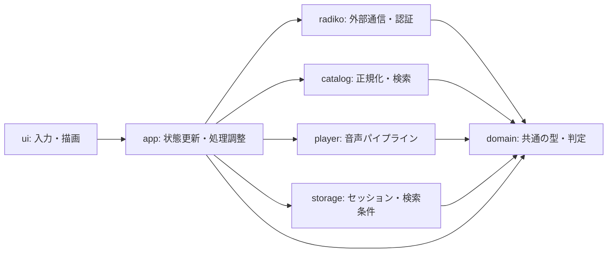
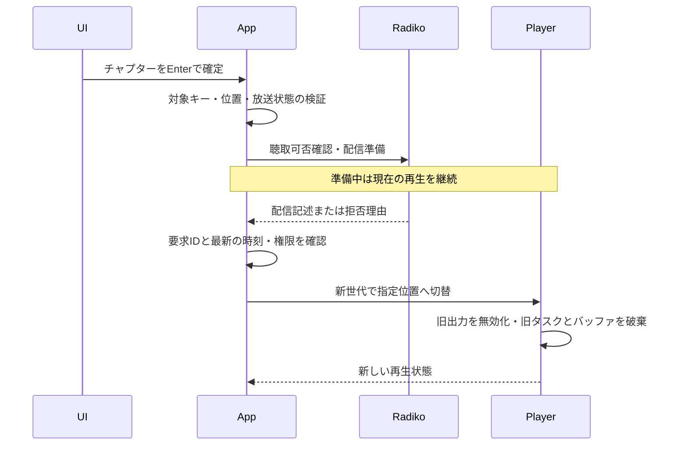

# アーキテクチャ設計

2026年10月15日策定。[機能設計](design.md)の仕様を実装へ落とすための構成・状態・処理境界を定義する。初期実装の進捗は[実装状況](implementation.md)に記録する。この設計書は実通信や再生の成立を示すものではない。

## 採用する方針

- 単一Cargoプロジェクトで開始し、画面、状態管理、外部通信、検索、音声処理を分離する。
- アプリ状態の更新は一つのイベントループに集約する。通信・デコードのタスクは状態を直接書き換えず、識別子付きの結果を返す。
- 検索、チャプター取得、再生準備、実行中の再生を独立して管理する。閲覧や検索の失敗は音声を停止させない。
- チャプターは公式AIチャプターを利用する。楽曲用の別API、独自AI生成、ポッドキャストは追加しない。
- 空のチャプター結果は「チャプター未提供」とする。生成待ちか恒久的な未提供かは断定せず、手動更新を提供する。
- 分割番組の時刻基準は実通信で検証し、検証できない対応付けではジャンプを許可しない。

## モジュールと依存方向

| 配置案 | 責務 |
|---|---|
| `src/main.rs` | 引数、初期化、終了コード |
| `src/domain/` | 放送枠、日時、検索条件、チャプター、聴取可否の型と純粋な判定 |
| `src/app/` | `AppState`、操作、イベント、非同期処理の起動・キャンセル |
| `src/radiko/` | HTTP、XML/JSONの外部DTO、番組・局・チャプター・認証・配信情報の取得 |
| `src/catalog/` | 局の選択、重複排除、分類集計、検索条件の適用 |
| `src/player/` | HLS、コンテナ解析、デコード、PCMバッファ、音声出力 |
| `src/storage/` | バージョン付き保存形式、原子的保存、ファイル権限 |
| `src/ui/` | キーから操作への変換、状態から描画用データへの変換、端末復元 |
| `tests/fixtures/` | 機密情報を除いたXML/JSON/HLSと生成音声 |

`domain`は通信・端末・音声ライブラリに依存しない。外部DTOは`radiko`内で検証してドメイン型へ変換する。`player`はradikoのログインを行わず、`app`が取得した配信記述を受け取る。更新が必要な配信情報はイベントで`app`へ要求する。署名付きURLや認証情報を含む型はログ向けの自動出力を避ける。

HTTPやプレイヤーの境界は差し替え可能なインターフェースとし、通常テストでは偽物を注入する。依存ライブラリのバージョン・feature・APIは実装時に確認して`Cargo.lock`で固定する。

## データモデル

以下はRust実装時の型の概念であり、外部APIのフィールド定義ではない。

| 型 | 主な内容・不変条件 |
|---|---|
| `ProgramKey` | `station_id`と`starts_at`。番組名・番組IDでは一致判定しない |
| `Program` | キー、終了日時、タイトル、出演者、説明、タグ、番組ジャンル、出演者分類、取得できた配信条件 |
| `BroadcastDay` | 日本時間の午前5時区切りの日付。実際の開始日時とは別に保持 |
| `SearchCriteria` | 単日／期間、地域、番組ジャンル、出演者分類、キーワード |
| `BroadcastStatus` | `Upcoming / OnAir / Finished`。時刻から算出 |
| `ListeningAvailability` | `Unknown / Allowed / Denied(reason)`。モード・契約・期限に依存 |
| `PlaybackTarget` | 放送枠のスナップショット、ライブ／タイムフリー、希望開始位置 |
| `EventBinding` | 対象キー、`eventId`、イベントの音声原点、放送枠との対応根拠。検証済みの場合のみ作成 |
| `Chapter` | 表示タイトル、要約、放送枠冒頭からの開始・終了時間、元配列の順序 |
| `ChapterSet` | 対象キー、有効項目、不正項目数、時刻基準の確認状態 |
| `PlaybackSnapshot` | 再生中の放送枠・モード・状態・出力済み位置・音量・終了／エラー理由 |

開始・終了日時は絶対時刻を保持し、表示・放送日計算は日本時間に統一する。経過位置は負値や非数を許さない時間型に変換する。外部IDは文字列を直接混用せず、番組IDと`eventId`を異なる型にする。

検索一覧、詳細選択、再生中の番組は別の所有データとする。検索結果の置換や詳細の変更で再生対象が消えないよう、プレイヤーに必要な番組情報は再生開始時に保持する。

## アプリ状態と処理の契約

`AppState`は検索条件の編集中／確定済み、取得進捗、詳細の選択キー、チャプター一覧、認証状態、再生状態、通知を保持する。UIは参照専用の状態から描画する。

| 操作 | 非同期処理と反映 |
|---|---|
| `CommitSearch(criteria)` | 検索世代を更新し、前の検索のみキャンセル。新しい一覧へ順次反映 |
| `OpenChapters(key)` / `RefreshChapters` | チャプター要求IDを更新。対応付け解決後に対象番組分を取得 |
| `Play(target)` / `PlayChapter(key, chapter)` | 対象・時刻の検証後に聴取可否確認と配信準備。同じ放送枠のタイムフリーならシーク経路を使用 |
| `Seek(position)` | タイムフリーの再生対象について準備し、確定後に音声世代を更新 |
| `Pause / Resume / Stop` | プレイヤーへ指示。ライブ再開時は最新位置を準備 |
| `Login / Logout` | セッション検証・保存／削除を行い、認証状態を更新 |
| `Quit` | 新規処理の停止、タスクキャンセル、音声停止、端末復元 |

イベントには`SearchId`、`ChapterRequestId`、`PlaybackRequestId`、`PlaybackGeneration`など処理領域ごとのIDを付ける。現在のIDと一致する結果だけ反映する。キャンセルだけに依存せず、すでに配送中の古い結果も破棄する。

制御・結果は容量上限付きチャネルで送り、再生位置など最新値だけが必要な通知は集約する。音声コールバックからイベントループを待たない。検索結果は局単位でバッチ化し、進捗と局ごとの失敗を保持する。全国取得の最大4並列は維持し、再生通信は検索用の実行枠を待たせない。

## 再生要求と切替

- 放送前・明確な権限不足・不正位置は準備前に拒否し、現在の再生を継続する。可否未確認なら必要な確認を行い、成功を推測しない。
- 配信準備の失敗や古くなった要求では切替を確定しない。新しい再生要求は古い準備処理だけをキャンセルする。
- 切替確定時に音声世代を更新する。以後、旧世代のPCMは出力しない。新しいデコードや出力に失敗した場合は理由を表示して停止し、旧番組へ自動復帰しない。
- 同じキーでもライブからチャプターを選ぶ場合はタイムフリーへ切り替える。単なるライブ位置へのシークにはしない。
- 一時停止中にチャプターを確定した場合は指定位置から再生を開始する。

プレイヤー状態は`Stopped / Buffering / Playing / Paused / Ended / Failed`とし、準備中の要求は現在の再生状態と別に保持する。番組終了後は`Ended`で止まり、自動で次の放送枠へ進まない。

## 音声パイプライン

`HLS取得 → 容量上限付き圧縮データ → 専用ワーカーで解析・デコード → 容量上限付きPCM → CPAL出力`とする。デコードはTokioの非同期実行スレッドを占有しない。対応形式と必要な変換は実配信検証後に確定する。

- 圧縮データとPCMにはバイト数・フレーム数の上限を設け、満杯では生成側を抑制する。初期値は連続再生検証で測定して決める。
- CPALコールバックは準備済みPCMの取り出しと出力、消費フレームの計数だけを行う。通信・デコード・ブロッキングロック・ファイル操作を持ち込まない。
- バッファ不足時は無音を出すが、無音補填分で番組内の再生位置を進めない。出力済みメディアフレームとシーク原点から位置を算出する。
- シークでは対象セグメントからデコードし、指定位置より前のサンプルを破棄する。セグメント境界へ丸めた位置をチャプター開始位置として表示しない。
- タイムフリーでは放送枠末尾を越えるサンプルを出力しない。ライブでは終了日時に出力を無効化し、バッファを破棄する。現在時刻との比較は描画処理に依存させない。
- 切替・停止で旧リングバッファを安全に無効化できる方式を採用する。世代変更の通知を受けるまで旧音声を流し続ける実装にはしない。

## チャプターの対応付けと正規化

`radiko`内で、放送局・開始終了日時から番組情報を解決し、`eventId`と音声原点の根拠を取得する。解決先APIや認証条件は実通信の調査結果で確定する。番組名の一致やXMLの番組IDの流用では補わない。

イベント原点を`E`、選択した放送枠開始を`P`、API開始秒数を`s`とした場合、原点が検証できたときだけ`E + s - P`で枠内位置へ変換する。イベント全体と分割枠の関係が不明なら`Unresolved`とする。別枠に属する項目や枠をまたぐ項目は初期版では切り詰めずジャンプ対象外とし、その件数を表示する。

- `isMusic=true`は除外し、別の楽曲APIは呼ばない。
- タイトルは空白だけの値を除いて`titleLong`、`title`の順に選び、両方空なら「無題」とする。表示文字列の端末制御文字を無害化する。
- 開始・終了とも有限の数値で、`0 <= start < end <= 放送枠長`を満たすものだけ採用する。未知のJSONフィールドは許容するが、必須構造の欠落は空配列と区別する。
- 開始位置で安定ソートする。現在位置が`start <= position < end`の項目を現在チャプターとし、重複時は開始位置が最も後のもの、同開始なら元配列で先のものを優先する。隙間では強調しない。
- チャプター一覧のカーソルと現在チャプターの強調は別に管理する。自動追従でユーザーの選択を変更しない。

取得状態は`NotRequested / Loading / Ready / Unavailable / Unresolved / Failed`とする。成功した空配列は`Unavailable`で「チャプター未提供」、有効項目ゼロの不正データは`Failed`で理由を表示する。404などの応答は実測して分類し、根拠なく空配列と同一視しない。

## 通信・エラー・永続化

通信には接続・リクエスト全体のタイムアウトとレスポンスサイズ上限を設ける。再生用とメタデータ用の要求設定を分け、HLSの期限やセグメント長に合わせた値は実測で定める。

通信断・一時的なサーバーエラーは最大3回の再試行とし、指数バックオフとジッターを使う。429は`Retry-After`を尊重する。待機が長い場合もUIを動かし、キャンセル可能にする。認証失効・権限不足・解析不整合を同じ条件で自動再試行しない。チャプターの失敗をプレイヤーの停止イベントへ変換しない。

エラーは通信、認証失効、契約不足、配信対象外、期限切れ、対応付け未確認、解析、未対応音声形式、出力機器、保存失敗に分類する。利用者向けの理由と診断用の安全な情報を分け、Cookie・トークン・パスワード・署名付きURLを出力しない。

保存対象はセッションと検索条件だけとする。番組表・局・分類・チャプター・音声・再生位置は永続化しない。セッション保存・破損時の扱い・権限は機能設計に従う。検索条件もバージョン付きとし、日付を当日に戻す起動復元と日付も適用する名前付き条件呼び出しを別処理にする。

## 起動と終了

起動時は端末復元ガードを用意し、保存情報を読み、セッション確認と当日の検索を進める。認証ファイルが読めなくても未ログインで探索を開始できる。

終了時は新規操作を止め、音声出力をまず無効化し、全タスクへキャンセルを通知する。期限を設けて終了を待ち、端末を復元する。通常終了、エラー、割り込み、パニック時の復元経路を用意する。終了待ちに音声コールバックからの応答を必須にしない。

## 実装段階と検証

1. **成立条件の検証**：契約認証、ライブ、7日以内・8〜30日前の配信、コンテナ・コーデックを確認する。チャプターは公開実装を手掛かりに取得・対応付け・時刻基準を確認し、日付・対象・手順・結果を記録する。
2. **音声コア**：生成音声とHLS fixtureでシーク・切替・番組末尾・不足時の位置計算を確認し、実配信を連続再生する。
3. **検索・メタデータ**：放送日・分類・重複排除・部分失敗・検索条件保存を実装する。チャプターのDTO変換と正規化を追加する。
4. **アプリとTUI**：世代管理と状態遷移を統合し、検索中の再生継続、別番組のチャプター再生、キーボード操作、終了処理を確認する。

通常テストは偽の時計・通信・プレイヤーを利用する。検索・チャプター・再生準備の完了順を逆転させ、古い結果の破棄を検証する。分割枠、生成待ちの空配列、楽曲除外、重複と隙間、再生不可時の継続、ライブからタイムフリーへの切替を確認する。実通信テストは明示実行に分け、未実施の項目を検証済みとしない。

Cargo作成後は開発ガイド所定のfmt・clippy・testを実行する。完成条件は実配信30分の連続再生中にも検索・チャプター操作が応答することとし、純Rustで再生が成立しなければ、その根拠を記録して方式を再検討する。
