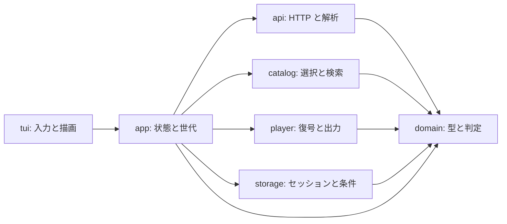

# アーキテクチャ

2026年10月28日時点の構成です。仕様の意味は [機能設計](design.md)、確認の範囲は [検証範囲](validation.md)、日付ごとの手順と数値は [実装状況](implementation.md) にあります。

画面は状態を直接変えません。通信とデコードの結果は、領域ごとの要求 ID を付けてメインループへ返し、ID が一致するものだけを反映します。キャンセルしたあとに届いた結果も捨てます。

## 依存の向き



`domain` は通信、端末、音声ライブラリに依存しません。外部の XML と JSON は `api` の中で検証してからドメインの型にします。`player` はログインをせず、`app` が解決した配信を受け取ります。署名付き URL と認証情報を持つ型は、ログ向けの自動出力を持ちません。

テストでは HTTP とプレイヤーの境界を偽物に差し替えます。通常のテストは radiko へ繋ぎません。

## クレート

ワークスペースは二つです。画面の依存はバイナリだけが持ちます。

| パッケージ | クレート | 役割 |
| --- | --- | --- |
| `crates/radiko` | `radiko` | 番組表、認証、再生、保存。Ratatui には依存しない |
| `crates/radiko-client` | バイナリ `radiko-client` | CLI と TUI。`radiko` を呼ぶ |

ライブラリの説明と、通信しない検索条件の例は `radiko` のクレートドキュメントにあります。よく使う型は `radiko::prelude` です。セッションと検索条件の保存先をまとめる型は `storage::DataDir` です。HTTP と XML・HLS の境界は `api` で、クレート名とモジュール名が重ならないようにしています。番組表の「どれを取るか」は `catalog`、XML の取得と解析は `api::catalog` です。`catalog::CatalogClient` は後者を取得元として再公開しています。

## ディレクトリ

パスは、ライブラリが `crates/radiko/src/`、CLI と TUI が `crates/radiko-client/src/` です。

| 場所 | 役割 |
| --- | --- |
| `radiko-client` の `main.rs` | 引数、終了コード、プローブ系 CLI |
| `radiko-client` の `tui.rs` と `tui/` | キーを操作へ変え、状態を描く。端末の復元。通信とデコードは呼ばない |
| `app.rs` と `app/` | メインループが所有する状態。検索、再生、チャプター、認証、名前付き条件のサービス |
| `domain.rs` と `domain/search.rs` | 放送枠、放送日、状態、検索条件、チャプター、聴取可否の表示 |
| `catalog.rs` と `catalog/search.rs` | 地域から局を選び、最大4並列で取得し、条件を適用する |
| `api.rs` と `api/` | 制限付き HTTP、会員認証、番組表、配信解決、HLS、チャプター |
| `player/` | AAC 復号、fragmented MP4、PCM の上限、CPAL 出力、再生ワーカー、診断 |
| `storage.rs` と `storage/searches.rs` | `session.json` と `searches.json` の原子的な読み書き。`DataDir` が同じディレクトリを返す |
| `programs.rs` `play.rs` `chapters.rs` `searches.rs` | 各 CLI。バイナリ側 |
| `stdout.rs` | CLI の標準出力。閉じたパイプは終了コード 141 で戻し、stderr には出さない |
| `crates/radiko/tests/` と `crates/radiko-client/tests/` | ライブラリと CLI の統合テスト |
| `tests/fixtures/` | 資格情報を含まない合成データ |

CLI が標準出力へ書く行は `stdout.rs` に集約する。読み手がパイプを閉じたときの `BrokenPipe` は、エラー行を足さず終了コード 141（128+SIGPIPE）で戻す。stderr の進捗と失敗表示は変えない。SIGPIPE を `unsafe` で既定に戻すことはしない。

採用バージョンは各クレートの `Cargo.toml` と、ワークスペースの `Cargo.lock` が正です。画面は Ratatui 0.29.0 と Crossterm 0.28.1 で、バイナリだけが依存します。出力は CPAL 0.16.0 と rtrb 0.3.2、AAC は `rusty_aac` 1.1.0、コンテナの解析に Symphonia 0.5、HTTP は reqwest 0.12（`rustls-tls`、blocking feature は使わない）、非同期ランタイムは Tokio です。CPAL の既定ホストは、macOS では CoreAudio、Linux では ALSA です。Linux のビルドは libasound にリンクします。JACK 機能は有効にしていません。

## メインループ

TUI は Tokio の current-thread ランタイムで、約50ms ごとに通知と、最大32件の入力を処理します。描画は状態の参照だけです。番組一覧とライブ画面の終了は `q`、Esc、Ctrl+C です。操作一覧、取得状況、ログアウト確認、名前付き条件、チャプター表示では `q` と Esc は閉じるだけで、Ctrl+C は終了です。ログアウト確認の `q` は取消であり、ログアウトは実行しません。キーワード、条件編集、ログイン、秒数の入力欄では `q` は文字（秒数欄は数字だけを受け付ける）、Esc は編集の取消、Ctrl+C は終了です。画面内ヘルプと `tui --help` は、終了とログアウト確認について同じ文言を使います。`AppState` が持つのを次に限っています。

- 確定済みの検索条件と、編集中の下書き
- 検索の状態、進捗、今回の番組、絞り込み後の添字
- 地域の失敗、局と放送日の失敗、不正枠の出所
- 再生スナップショット。検索のイベントからは書き換えない
- チャプターの対象と状態
- 認証の表示状態。契約フラグだけで、Cookie とトークンは持たない

サービスは領域ごとに一つです。

| サービス | 同時に動かす量 |
| --- | --- |
| 検索 `app::search` | 実行中1件と、最新の待機1件。進捗チャネルの容量4 |
| チャプター `app::chapters` | 実行中1件と、最新の待機1件 |
| セッション確認 `app::auth` | 実行中1件と、最新の待機1件。起動時と `a` |
| ログインとログアウト | 受理した1件。追加は積まない |
| 名前付き条件 `app::named` | ファイル操作は1件。動作中の追加は受けない |
| 再生 `app::playback` | 操作チャネルの容量4。制御スレッドは1本 |

検索の世代を進めると、古い取得の進捗と完了は捨てます。チャプター、認証、再生準備、名前付き条件の表示も、それぞれの ID で古い結果を捨てます。検索の失敗から再生停止は作りません。

## 番組表の取得

`catalog` は差し替え可能な取得元を通します。地域の重複を除き、地域別の局一覧を取り、局 ID の和を作ってから、局と放送日の組を取得します。地域の発見は期間全体で一度です。番組表のジョブは、全局・全日を通してワーカー最大4、結果チャネル容量4です。日付ごとに別の4並列は起動しません。

公開の番組表は `/v3/program/station/date/{YYYYMMDD}/{station}.xml`、局一覧は `/v3/station/list/{JP1..JP47}.xml` です。gzip の展開は flate2 です。圧縮の前後とも最大4MiB、XML の深さ32、1応答の放送枠2048、局一覧は応答あたり最大512局です。壊れた個別の枠は件数を出して除外し、全枠が不正、局が一致しない、構造が不正、なら失敗します。失敗した地域の局数は推測しません。

`tui --offline` はテストと CI 専用で、ヘルプには出さない。利用者向けの起動オプションではない。引数の分解は手書きの `split_args` である。`CatalogClient` も `Http` も作りません。バイナリの `tui/offline.rs` が `catalog::Source` を実装し、試験用の1局1番組をメモリで返します。`SessionStore` と `SearchStore` は作らず、`session.json` と `searches.json` を読まない、書かない、消さない。ログアウトの削除はファイルを開かない空の処理で、画面の `O` と `y` はその処理へ進みません。再生準備の工場とチャプター取得は、通信と CPAL を呼ばずに失敗を返します。ログインのキーは入力欄を開かず、認証の再確認キーも通信しません。Ubuntu 24.04 の「Format, lint, and tests」ジョブは、Rust のテストのあと、権限のない `unshare -rn` の中で `scripts/smoke_tui.py` を一度実行します。AppArmor がユーザ名前空間を拒むときは、先に `kernel.apparmor_restrict_unprivileged_userns=0` にしてから同じ `unshare -rn` を使います。スモークの前に、その名前空間から `1.1.1.1:443` へ TCP 接続できないことを確認します。macOS のジョブと Rust 1.85.0 のジョブには、この手順はありません。

`catalog::search::Filter` は入出力を持たない判定です。観測分類は、絞り込む前の今回の取得から集計します。キーワードは小文字化した文字列を一度作り、各欄の部分一致に使います。分類 ID は各128バイト、キーワードは1024バイトが上限です。

複数日の JSON は `date_range`、予定した取得数、成功した局数、成功した局と日の数を分けます。一部の失敗は `complete=false` と終了コード1です。

## 再生の準備と切り替え

`player::seek::Controller` が、容量1の最新要求、準備ワーカー1本、結果チャネル容量1、世代番号を持ちます。シーク、再開、別の枠への切り替えは同じ経路です。新しい要求は古い準備の停止トークンを取り消します。

準備では、放送枠、契約、配信条件を通常の再生と同じように確認します。枠の外なら配信認証の前に拒否します。タイムフリーの非ゼロ位置は、希望位置の約10秒前から `seek` し、プレイリストの `l` は60秒です。ライブの `l` は15秒です。`l` は要求する一覧の長さであり、PCM をその秒数だけ先に持つことではありません。応答の一覧を正とします。

`PROGRAM-DATE-TIME` が希望位置に対応しない応答は失敗します。番組 ID や URL から時刻は推定しません。プリロールをデコードし、希望位置より前の PCM をフレーム単位で捨てます。先頭フレームが希望時刻より前にならないよう、切り捨ては切り上げます。

2秒分（末尾付近は残り）の PCM と、新しい出力機器の準備が成功してから、古い世代だけを止めます。機器を開けなければ古い出力を維持します。準備中は二世代の有界な PCM が一時的にあり得ます。スレッドを要求の数だけ増やすことはしません。

ライブの要求には選択枠の開始時刻を付け、公開の番組表を取り直して局と開始を照合します。停止期限は、取り直した同じ枠の終了時刻です。次の番組は解決し直しません。

TUI の再生サービスは、放送前を通信の前に拒否します。それ以外は準備ワーカーの中でセッションを読み、会員確認をしてから同じ準備へ渡します。CPAL の stream は再生制御スレッドの中で作り、画面へは渡しません。`s` とサービスの drop は親の停止トークンを直接取り消し、操作チャネルの空きや HTTP の完了を待たずにコールバックを無音にします。終了時は、再生関数が返って出力を破棄した直後にその通知を立て、準備ワーカーの join より前にします。TUI と drop はその通知を最大1秒待ち、HTTP の完了は待ちません。1秒を超えても、制御スレッドは切り離して終了を続けます。

CLI の対話入力は、`--interactive` のときだけ別スレッドが行単位で読み、容量4のチャネルへ送ります。raw mode は使いません。進捗の表示は CLI が5秒、TUI が250ms です。

再生の状態は `Buffering`、`Playing`、`Paused` です。スナップショットは今の対象と、準備中の要求を別の欄に持ちます。番組の終了は `EndReason::ProgramEnd`、指定秒数は `Limit`、中断は `Cancelled` です。終了したあとに新しい再生を始めるときは、古いスナップショットと診断を消してから新しいものを反映します。切り替えの準備中は、この初期化をしません。

## 音声パイプライン

```text
HLS 取得 → 圧縮データ（1セグメント最大 8MiB）
        → ワーカーで解析と復号
        → PCM（1セグメント最大 4MiB、待ちキュー 2）
        → 2秒のリング
        → CPAL コールバック
```

ワーカーは1本です。キューの外に、主制御が持つ現在の PCM と、ワーカーの配送待ちが各1個あり得ます。待ちの観測は最大3個です。キューが満杯のあいだは次の取得へ進みません。開始に必要な量は2秒のままで、キューを満たすために開始を遅らせません。

コールバックが行うのは、フレームの取り出し、ゲイン、f32 から開いた形式への変換、コピー、無音の補填、カウンターの更新です。割り当て、ロック、通信、復号、ファイル操作はしません。不足の無音はメディア位置を進めません。機器エラーは無音にして呼び出し元へ失敗を返します。`ContinuousOutput::poll` の間隔が1秒より長いときは、プロセスの一時停止として基準を戻し、コールバック停止にはしません。戻したあともコールバックが3秒進まなければ出力を作り直します。間隔が1秒以内のままコールバックが3秒進まないときは、これまでどおり `OutputError::Stalled` です。ライブで新しい PCM が30秒来ないときは、無音のままプレイリストを取り直します。再取得の待ちは1秒から倍々で、10秒が上限です。認証拒否、403、404、429、取り消しは再取得しません。再生が始まってからの再接続は、止まった時間を除いて5分までです。上限と、作り直しの失敗は「再接続の上限を超えたため再生を停止しました。番組を選び直して再生してください」です。画面は「再接続中…（N秒）」です。開始前の最初の PCM が30秒来ないときは、これまでどおり止めます。末尾の drain は250ms です。

出力の総フレームは、番組の残りと `--seconds` の小さい方で制限します。タイムフリーで `ENDLIST` が枠長より100ms を超えて早いときは失敗です。それ以内の端数は、渡したフレーム数で終端を確定します。

### デコード

ADTS は `player::aac::AdtsDecoder` です。パケット境界を検証し、同じインスタンスで重なりと SBR の状態を保持します。セグメントは8MiB、4096パケットまでです。CRC、複数 raw block、PCE は復号の前に拒否します。取り消しは、走査と各パケットの前後で見ます。1パケットの復号呼び出しの途中では止まりません。取り消しと失敗では部分 PCM とデコーダー状態を捨てます。

非 ADTS の連続再生は `player::fragmented::FragmentedAacDecoder` です。`HlsStream` が、現在位置までの最後の `EXT-X-MAP` を最大1MiB で取り、URI が同じあいだは再取得しません。初期化から ASC を取り、パケットの位置、長さ、`tfdt` は自前のボックス読み取りで見ます。単一の AAC トラック、単一の traf/trun/mdat、movie fragment 相対の位置、編集リストなし、に限ります。外部データ、保護された記述は拒否します。

fragment の PCM の長さと `EXTINF`、観測した `PROGRAM-DATE-TIME` の差と `tfdt` の差は、2ms 以内の一致を要求します。`tfdt` をそのまま日本時間にはしません。初期化の内容が変わる、ADTS と切り替わるときは、明示的な不連続がなければ拒否します。不連続ではデコーダーと時刻の照合を新しく作ります。

MP4 を Symphonia へ渡す前に、`player::mp4_limits` がボックスを深さ16、総数8192まで見ます。サンプルテーブルと fragment の宣言件数、`stts` の展開数、`stsz`、`stz2`、`trun` の合計は4096までです。巨大な `trun` の宣言でパーサーが長く回るのを、呼び出しの前に拒みます。

`RawAacDecoder` は AAC-LC のコア、1024フレーム、チャンネル構成1〜7を受けます。ASC は2〜1024バイトです。SBR を HLS または ASC が宣言しているときは、実データの検出と、拡張後のレートの一致を要求します。ASC の `ps` が真のときだけ、成功後の要約で PS 明示ありにします。

完結したコンテナの明示 PCM API と、隣接コンテナで ASC が同じあいだ状態を保つ API は、プローブと比較のためのものです。HLS の連続再生が使うのは、上の ADTS と fragmented の経路です。Symphonia はコンテナの解析と、AAC 以外のサンプルの判別に使い、HE-AAC のコアだけを復号して成功にはしません。

実配信でこの範囲の外の形式が必須だと分かったら、根拠を実装状況へ書き、設計を見直します。外部プレイヤーへは自動で切り替えません。

### 既定の出力機器

再生と `output-info` は、その時点の CPAL 既定出力と同じ名前の列挙デバイスを開きます。名前が一致しなければ CPAL の default へ戻ります。

macOS では、CPAL 0.16.0 の default ラッパーは `DeviceIsAlive` を付けず、後の OS 既定変更へ追従する出力ユニットを使います。同じ名前の列挙デバイスでは、消滅が既存の `OutputError::Device` になります。機器が残ったまま既定だけが変わる場合、開いたストリームは移動しません。

Linux では、CPAL 0.16.0 の ALSA ホストが既定の名前を `default` に固定します。列挙の先頭に同じ名前の PCM があれば、それを開きます。列挙は、開ける `default`、`pipewire`、`pulse`、`jack`、`oss` と、カード名の `plughw` です。名前が `default` と違うものは選びません。ALSA が `POLLERR` を返すと CPAL は `StreamError` にし、このプレイヤーは同じ `OutputError::Device` にします。この切断と、`default` プラグインがデスクトップの既定を追うかは、実機では未確認です。機器の問い合わせに失敗したとき、Linux では `OutputError::NoDevice`（「既定の音声出力機器がありません」）にします。

ALSA ライブラリの診断は、CPAL を呼ぶ前に `snd_lib_error_set_handler` で黙らせます。ハンドラはメッセージを読まず、戻り値の失敗はこれまでどおり日本語のエラーにします。`RADIKO_ALSA_LOG=1` のときは差し替えず、ALSA の既定の stderr 出力を残します。

採用する形式は、要求レートを含む mono または stereo の f32、i32、i16 です。優先は f32、次に i32、次に i16 で、同じ形式ならチャンネル数が多い方です。整数のときはコールバック内で f32 をクリップしてから変換します。レート変換はしません。一致が無いときは、要求レートと機器が宣言した範囲を `OutputError::IncompatibleOutput` に載せます。

`inspect_default_output` はストリームを作らず、対応構成の宣言だけを読みます。名前は制御文字を除いて256文字までです。`output-info` と `probe-output` は、採用した形式（f32、i16、i32）を表示します。

## HTTP と取り消し

共通の `Http` は非同期の reqwest です。取得ワーカーの上で、共有の current-thread ランタイムが future を駆動します。要求ごとの通信スレッドは作りません。待ちは10ms 間隔で取り消しを見て、future を捨てます。ヘッダー待ち、本文の受信、再試行の待ち、リダイレクトの前後で見ます。取り消したときは部分の本文を返しません。

読み取り専用の GET は、ヘッダー待ちの通信断、HTTP 408 と 5xx、本文の途中の通信断を、同じ要求先ごとに最大3回まで最初から送り直します。部分の本文は捨てます。取り消し、認証拒否（401 と 403）、404、429、サイズ超過、不正な範囲は、この HTTP 層では再試行しません。認証の `request_once` とログイン POST はこの再試行に入れません。会員確認の GET だけが最大3回再試行し、取り消しを失効や通信断として再試行しません。認証の成功本文は最大64KiB です。

DNS は共有の最大4ブロッキングスレッドと、許可4のセマフォです。OS の名前解決そのものは中断できないので、取り消したあとも、その処理が終わるまで許可を保持します。許可待ちで取り消したものは、新しい DNS を始めません。一件の取り消しを、他の取得へは広げません。

検索、チャプター、会員確認、再生準備、再生中の HLS、再生 CLI の初回と対話の準備が、それぞれの世代から停止トークンを渡します。音声の停止は、HTTP の完了を待ちません。

再生中の失敗には、音声取得とプレイリスト更新の段階名を付けます。URL、本文、資格情報は足しません。失敗で通し番号を進めません。局一覧 XML から配信先を選び直すことはしません。例外は、再生が始まったあとのライブで、いま更新しているプレイリスト URL が HTTP 404、または認証切れの 401/403 のときです。その URL はリダイレクト後のメディアプレイリスト（chunklist）です。最初の配信 URL（リダイレクト前の playlist 作成 URL）からマスターも含めて引き直し、新しいメディアプレイリストを、これまでと同じ追いつきと巻き戻り判定に渡します。

例外は、再生中のプレイリスト更新、初期化情報、音声セグメントが HTTP 401 のときだけです。保存してある会員セッションで `authenticate` を1回やり直し、新しい `x-radiko-authtoken` に差し替えます。プレイリストは同じ URL を1回取り直します。セグメントと初期化情報は、そのトークンでプレイリストを取り直してから、同じ通し番号を1回取り直します。取り直しには新しいトークンを付けます。成功した応答の音声だけを通し番号へ進め、401 のバイト列は返しません。再認証が失敗したとき、または取り直しも 401 のときは、通し番号を進めずに「認証期限切れ」で停止します。成功した再認証のあと 20 秒は、次の 401 で `authenticate` を呼ばず、持っているトークンで1回だけ取り直します。それでも 401 なら同じエラーで停止します。開始前とタイムフリーの 403 はアクセス拒否のまま、429 はアクセス制限のままで、どちらも再認証しません。ライブで再生が始まったあとのプレイリスト更新は、401/403 でも失効した chunklist を繰り返さず、最初の配信 URL から引き直します。取り消し、通信失敗、429 は期限切れとは別の文言です。再認証の通信も、再生と同じ取り消しを見ます。完了した再認証の回数だけを通信診断に足し、トークンと URL は残しません。TUI はその回数の増加で認証行と再生通知を変え、「認証期限切れ」の停止では認証行に再確認を足します。

プレイリストは1MiB、4096項目、target duration は1〜60秒です。更新があったあとは target duration、変化がなければその半分を再取得の間隔にします。間隔は前の取得の開始から数え、応答待ちを二重には足しません。`MEDIA-SEQUENCE` で取得済みを除き、署名付き URL の変化を別セグメントとは扱いません。

ライブで、次に取る通し番号が新しいプレイリストに無いときは、再生を止めずに追いつきます。再開位置は、プレイリストの終端から target duration の3倍以内に始まるセグメントのうち、最も古いものです。窓全体がその範囲に収まるときは、先頭の `MEDIA-SEQUENCE` です。先頭から再開したときは「配信窓の先頭から再開しました（累計N）」、それより内側のライブ端から再開したときは「ライブ端に追いつきました（飛ばしたセグメントは累計N）」と TUI に出します。次のセグメントは不連続としてデコーダーを作り直します。

`MEDIA-SEQUENCE` が小さくても、次のときは古い応答として無視します。次の番号は動かさず、何も再生せず、デコーダーと巻き戻り回数も変えずに、次の取得を待ちます。新しい窓が最後に再生した番号より前から始まり、その番号より後ろまで続いているときも同じです。

- 新しい範囲に次の番号が含まれるか、その直前で終わっている。
- 新しい窓の末尾が、最後に再生した番号から、そのプレイリストのセグメント数以内だけ前にある。1セグメントなら 12 の次の 11 は無視し、10 はリセットです。6セグメントで 12〜17 のあとに 11〜16 が届いても無視します。

末尾がそれより前ならリセットです。大きく小さい番号からの配信の切り替わりもリセットのままです。この無視に上限がないと、本当に小さな番号から再開した配信まで待ち続けます。

次の番号より新しい `MEDIA-SEQUENCE` との差が、そのプレイリストのセグメント数以下のときは、飛ばした通し番号を通信診断に足します。差がその個数より大きいときはリセットにし、差そのものは足しません。リセットで捨てた、新しい窓より前の番号も足しません。窓の中で端まで進む分だけを足します。巻き戻り回数は、リセットのときだけ通信診断に足します。タイムフリーは、未取得番号が窓から消えたときも、番号が巻き戻ったときも、失敗のままです。失敗では通し番号を進めません。

再生が一度セグメントを返したあとの通信失敗は、ライブもタイムフリーも、その場では止めません。対象は、通信失敗と HTTP 408、500番台です。プレイリストを取り直し、成功した応答はこれまでと同じ `install_playlist` に渡します。ライブの追いつきと、少し古い窓を無視する判定はそのままです。タイムフリーは取り直した窓に次の番号が残っていれば続きから再生し、外れていれば `WindowLost` で止めます。文言は「通信が長く途切れたため、続きを再生できなくなりました。番組を選び直してください」です。プレイリストの形式エラーにはしません。待ちは1秒、2秒、4秒、8秒、以降10秒です。再接続の上限は `reconnect::LIMIT` の5分で、出力の作り直しと共有します。認証の更新そのものが拒否されたとき、429、取り消しは、この待ちに入りません。ライブで再生が始まったあとのプレイリスト更新の 404 と、認証切れの 401/403 は、最初の配信 URL からの取り直しとしてこの待ちに入ります。タイムフリーの 404 は、これまでどおりその場で止めます。

## チャプターの対応付け

`api::stream::chapters` が番組を解決し、応答の `eventId` と `episodeIntroductionStartAt` を見ます。XML の番組 ID は使いません。チャプター応答の局 ID とイベント ID が要求と違えば失敗です。応答は最大1MiB、イベント ID は ASCII の英数字、ハイフン、アンダースコアで最大128文字です。会員の Cookie とトークンは送りません。

原点が枠の開始と一致するときだけ `EventBinding` を作り、`Outcome::Aligned` にします。情報がない、原点が違う、枠が一致しないときは `Unresolved` で、補正量は作りません。原点が違う場合はチャプター API も呼びません。`Outcome::Candidates` は参照位置であり、シークの対象ではありません。TUI がジャンプに使うのは `Aligned` だけです。

位置の正規化は `parse_chapters` です。`0 <= start < end <= 枠長` のものだけを採用し、枠をまたぐ項目は切り詰めずに除外します。成功した空配列は未提供、必須構造の欠落は失敗です。現在の章は `ChapterSet::current` が、再生対象と閲覧対象が一致するときだけ選びます。

`app::chapters` は対象の番組のスナップショットと要求 ID を持ち、閉じるとデータを捨てます。取得の前後で取り消しを見ます。

## 保存

`SessionStore` と `SearchStore` は、同じ `--data-dir` の `session.json` と `searches.json` です。どちらもバージョン付き JSON で、一時ファイル経由で原子的に置き、Unix ではディレクトリ `0700`、ファイル `0600` です。セッションは最大16KiB、検索条件は最大128KiB です。未知のフィールド、未対応のバージョン、権限の異常、シンボリックリンクは拒否します。省略時のディレクトリは `directories` 6.0.0 の `data_local_dir` です。macOS は `~/Library/Application Support/jp.radiko-client.radiko-client`、Linux は `$XDG_DATA_HOME/radiko-client`、未設定なら `~/.local/share/radiko-client` です。

検索条件の更新は `searches.lock` を開き、待たない `flock` で読み込みから原子的な書き込みまでを包みます。競合したら失敗を返します。読み込みは、置換の前か後の完全な JSON です。起動用の復元は日付範囲を当日1日へ置き換え、名前付きの呼び出しは保存した範囲を維持します。デシリアライズ時に `Filter` を再構築し、キーワードの小文字化もやり直します。

番組表、局、分類一覧、チャプター、音声、再生位置、画面がライブかどうかは保存しません。

## 診断の所有

`player::diagnostics::Tracker` を再生ワーカーが `Arc<Mutex<_>>` で持ちます。ロックは段階と数値の更新、スナップショットのコピーだけに使い、通信、復号、待ち、音声コールバックでは取りません。ロックの失敗で再生は失敗させません。履歴の配列は持たず、実時間の最大と、現在の段階の経過だけです。

待機 PCM の加算と減算は、同じ短いロックの中で行います。受け取ったあとの変換では再減算せず、まだ受け取っていない PCM を取り消しや切断で捨てるときだけ減算します。最長の取得には、その取得が始まったときの待機時間と、取得中の最少の待機時間を組で残します。あとの短い取得では、その組を混ぜません。

再生用の `Http` だけが `RequestMeasurements` を持ちます。応答待ちは `send` 全体です。試行数は、送信が終わったことやサーバーへ届いたことの証明ではありません。再試行待ちの数は、取り消して次を送らなかった場合も含みます。通信エラーの原文は捨て、失敗の総数、タイムアウト、接続失敗の3つの数だけを飽和加算します。HTTP の状態番号は現在の試行の任意値で、次の試行の開始で消します。番組表と会員認証の HTTP は、この計測に入れません。

エラーで再生ループを離れるときは、定期通知を待たず、今のカウンターと診断をもう一度通知します。出力を作る前の失敗では出力を空にします。

手動検証のスクリプトは、画面の既知の診断行から段階名と数値だけを読みます。URL、本文、端末の内容、番組のタイトルに含まれる数字は使いません。

## 終了

端末を触る前に復元ガードを作ります。通常終了、初期化の失敗、エラー、パニックフックで raw mode と代替画面を戻します。Ctrl+C、SIGINT、SIGTERM、SIGHUP は終了要求にします。`ctrlc` の termination 機能を有効にし、登録済みのハンドラーを共用します。

終了時は新しい操作を止め、音声出力を閉じ、取得へ取り消しを通知します。出力を閉じた通知は最大1秒待ち、その待ちに実行中の HTTP は含めません。1秒を超えても端末は戻します。ランタイムの待ちは200ms で、実行中の HTTP が終わることは端末復元の条件にしません。名前付き条件の、すでに受理した書き込みも最大200ms だけ待ちます。SIGKILL ではこの経路を通りません。

OS の名前解決と、単一 AAC パケットの復号呼び出しは、この取り消しでは途中で切れません。
